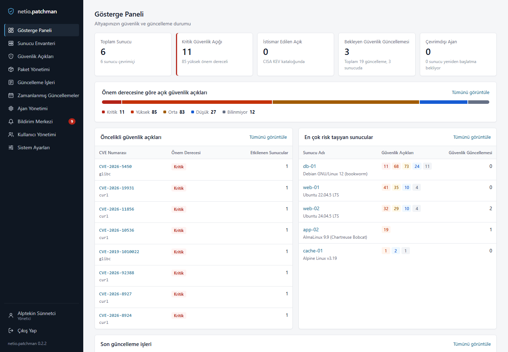
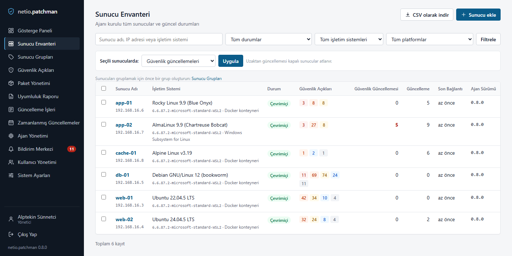
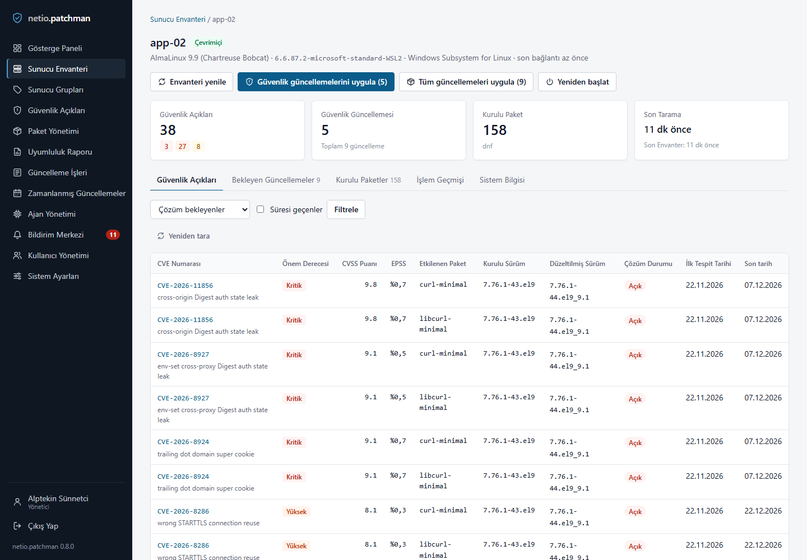
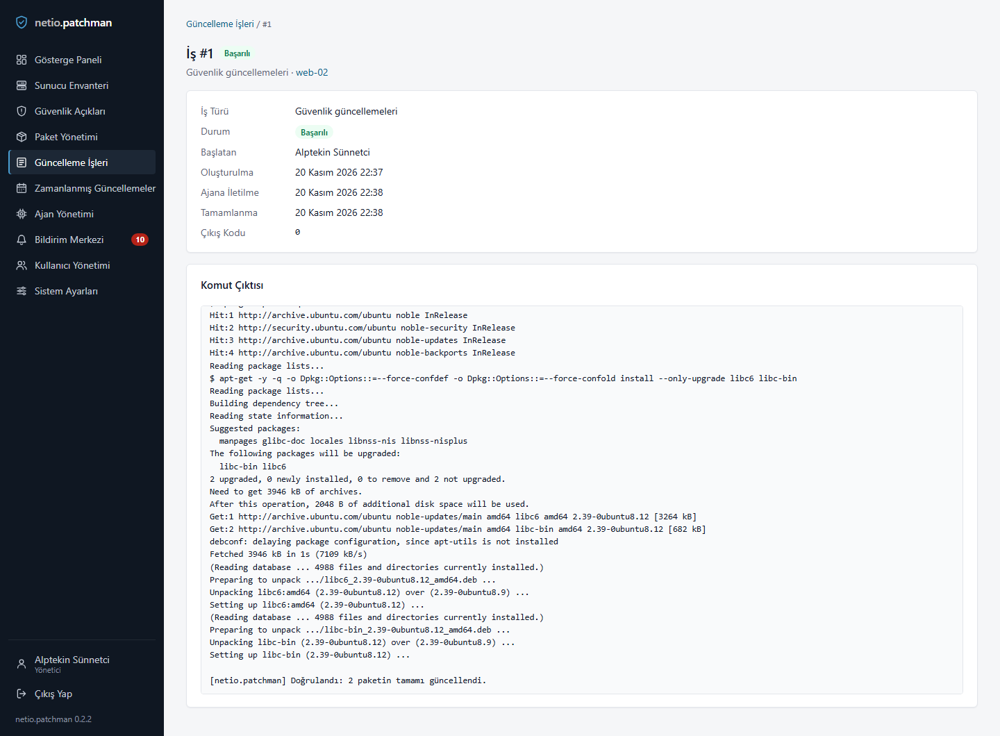
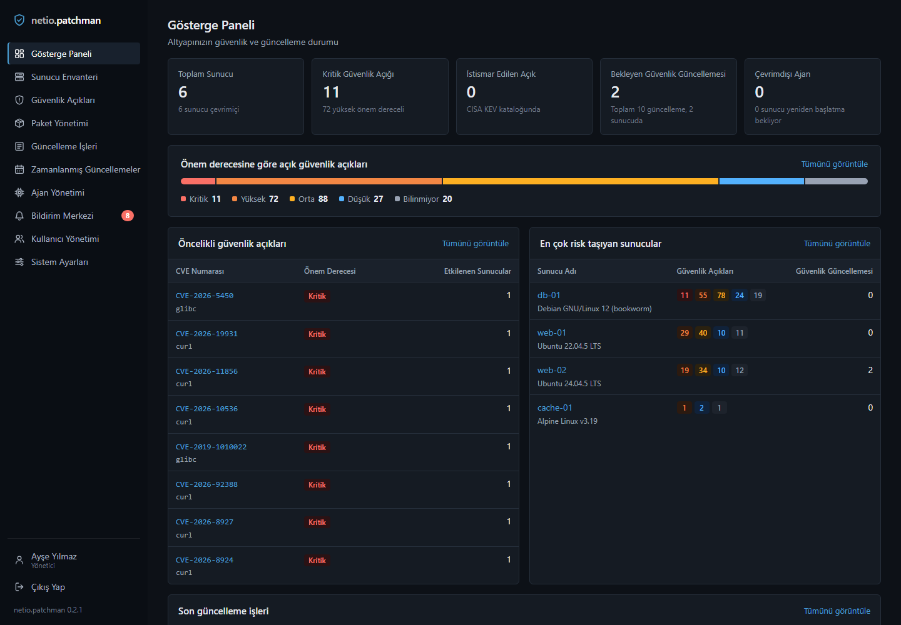

# netio.patchman

**Zentrales Schwachstellen- und Update-Management für Linux**

[Türkçe](README.md) · [English](README.en.md) · **Deutsch** · [Русский](README.ru.md)

netio.patchman ist eine selbst gehostete Plattform, mit der Sie die Schwachstellen und Paketupdates von Hunderten Linux-Servern über ein einziges Dashboard überwachen und verwalten.

- Der zentrale Server ist ein einzelner Docker-Container mit eingebetteter SQLite-Datenbank. Es ist kein separater Datenbank-, Warteschlangen- oder Cache-Dienst nötig.
- Auf jedem verwalteten Server wird ein kleiner Agent installiert. Der Agent öffnet keine Ports; er verbindet sich selbst mit dem zentralen Server.
- Die Weboberfläche gibt es auf Türkisch, Englisch, Deutsch und Russisch; jeder Benutzer wählt seine Sprache. CVE-Daten werden genau so angezeigt, wie die Quelle sie veröffentlicht, und nie übersetzt.

> [!WARNING]
> **Die Nutzung erfolgt vollständig auf eigenes Risiko.** netio.patchman aktualisiert Pakete und startet Dienste und Server auf Ihren Maschinen neu. Die Software wird „wie besehen“ und ohne jede Gewährleistung bereitgestellt. Für alle Schäden aus der Nutzung, einschließlich Datenverlust, Dienstausfällen, fehlgeschlagener Updates und Sicherheitslücken, ist die Person oder Organisation verantwortlich, die die Software installiert und nutzt. Details: [Haftungsausschluss](#haftungsausschluss).



## Inhalt

- [Funktionen](#funktionen)
- [Screenshots](#screenshots)
- [Funktionsweise](#funktionsweise)
- [Installation (Docker)](#installation-docker)
- [Agent auf Servern installieren](#agent-auf-servern-installieren)
- [Aktualisierung, Sicherung und Entfernung](#aktualisierung-sicherung-und-entfernung)
- [Konfiguration](#konfiguration)
- [Fehlerbehebung](#fehlerbehebung)
- [Sprache und Lokalisierung](#sprache-und-lokalisierung)
- [Sicherheit](#sicherheit)
- [Entwicklung](#entwicklung)
- [Haftungsausschluss](#haftungsausschluss)
- [Lizenz](#lizenz)

## Funktionen

- **Serverinventar:** Betriebssystem, Kernel, IP-Adressen, installierte Pakete, ausstehende Updates, Neustartstatus und Dienste, die noch alten Code ausführen.
- **Schwachstellenscan:** Installierte Paketversionen werden über [OSV.dev](https://osv.dev) mit den offiziellen Sicherheitsdaten der Distributionen abgeglichen. CVSS-Wert, Schweregrad, korrigierte Version und Herstellerhinweise werden angezeigt.
- **Bekannt ausgenutzte Schwachstellen:** Schwachstellen aus dem CISA-Katalog Known Exploited Vulnerabilities (KEV) werden markiert und priorisiert.
- **Zentrale Updates:** Installieren Sie Sicherheitsupdates, alle Updates oder ausgewählte Pakete auf einem, auf ausgewählten oder auf allen Servern direkt im Dashboard. **Korrektur anwenden** bei einer CVE aktualisiert die betroffenen Pakete auf allen betroffenen Servern. Nach jedem Auftrag prüft der Agent, ob die Pakete tatsächlich aktualisiert wurden; nicht aktualisierte Pakete werden aufgelistet und können mit einem Klick erneut versucht werden.
- **Neustart von Diensten und Servern:** Dienste, die noch alte Versionen aktualisierter Bibliotheken verwenden, werden erkannt und können im Dashboard neu gestartet werden; Server können im Dashboard neu gestartet werden.
- **Geplante Updates:** Wartungsfenster wie „jeden Sonntag um 03:00 Sicherheitsupdates auf Ubuntu-Servern installieren“. Zeitpläne starten Server nie selbst neu.
- **Automatische Agentenupdates:** Wechselt der zentrale Server auf eine neue Version, laden die Agenten sie herunter, prüfen die SHA-256-Prüfsumme und aktualisieren sich selbst.
- **Hinweis auf neue Versionen:** Das Dashboard informiert Administratoren, wenn auf GitHub eine neue netio.patchman-Version erscheint, und zeigt die Update-Befehle. Für Installationen ohne Internetzugang abschaltbar.
- **Befundverwaltung:** Status Offen, In Bearbeitung, Risiko akzeptiert und Fehlalarm. Wird ein Paket aktualisiert, wird der Befund automatisch „Behoben“. Risiken werden befristet akzeptiert (30, 90, 180 oder 365 Tage; das Maximum wird in den Einstellungen festgelegt). Nach Ablauf wird der Befund wieder geöffnet und es werden Benachrichtigung und E-Mail gesendet.
- **Servergruppen:** Teilen Sie Server in Gruppen wie „Produktion“, „Test“ oder „Datenbank“ ein. Ein Server kann mehreren Gruppen angehören. Listen lassen sich nach Gruppe filtern, geplante Updates können eine Gruppe als Ziel haben, Berichte können pro Gruppe erstellt werden.
- **Plattforminformation:** Der Agent meldet, ob der Server eine virtuelle Maschine (VMware, Hyper-V, KVM, Xen, VirtualBox), ein Docker/LXC-Container oder ein physischer Server ist. Die Serverliste lässt sich nach Plattform filtern.
- **Neustartverfolgung:** Wurde ein neuer Kernel installiert, der Server aber nicht neu gestartet, wird dies zusammen mit der Wartezeit angezeigt. Das Dashboard hat dafür eine eigene Kachel und einen Filter. Auch unter Debian (ohne `/var/run/reboot-required`) und Alpine wird dies durch Kernelvergleich erkannt.
- **Verlaufsdiagramme:** Der Server erfasst den Zustand der Flotte täglich. Das Dashboard zeigt für die letzten 30 Tage kritische und hohe Schwachstellen, aktiv ausgenutzte Schwachstellen, offene Befunde und ausstehende Sicherheitsupdates als Diagramme und Tabelle.
- **Compliance-Bericht:** Ein druckbarer Bericht (im Browser als PDF speicherbar) für einen gewählten Zeitraum und eine Gruppe: Kennzahlen, im Zeitraum erkannte und behobene Befunde, mittlere Behebungszeit, KEV-Schwachstellen nach Ablauf der CISA-Frist, Serverstatus, akzeptierte Risiken (mit akzeptierender Person und Ablaufdatum) und Update-Aufträge. Geeignet als Nachweis bei ISO-27001- und ähnlichen Audits.
- **Zwei-Faktor-Authentifizierung:** TOTP-Codes aus Apps wie Google Authenticator oder Microsoft Authenticator sowie einmalige Wiederherstellungscodes. Administratoren können sie für alle Benutzer vorschreiben und bei verlorenem Telefon für einen Benutzer zurücksetzen.
- **Benachrichtigungen:** Benachrichtigungszentrale und E-Mail-Benachrichtigungen für neue Schwachstellen, getrennte Agenten und fehlgeschlagene oder teilweise abgeschlossene Update-Aufträge.
- **Slack, Microsoft Teams, Telegram und Webhooks:** Benachrichtigungen werden, gefiltert nach Stufe (Info, Warnung, Kritisch), auch an Chat-Kanäle und über HMAC-SHA256-signierte JSON-Webhooks an eigene Systeme (SIEM, Incident-Management) gesendet.
- **Automatische Sicherungen:** Die Datenbank wird täglich zu einer festgelegten Uhrzeit gesichert, die neuesten N Sicherungen bleiben erhalten. Sicherungen lassen sich im Dashboard herunterladen; fehlgeschlagene Sicherungen werden gemeldet.
- **Mehrsprachige Oberfläche:** Türkisch, Englisch, Deutsch und Russisch. Jeder Benutzer wählt seine Sprache; Datum, Dezimaltrennzeichen und CSV-Format richten sich nach der Sprache.
- **Benutzer und Rollen:** Rollen Administrator, Operator und Betrachter; Prüfprotokoll.
- **Konfiguration im Dashboard:** SMTP, Serveradresse, Zeitzone, Datenquellen und alle Betriebseinstellungen werden im Dashboard geändert. Änderungen gelten ohne Neustart.
- **Export:** Server- und Schwachstellenlisten lassen sich als Excel-kompatible CSV-Dateien herunterladen.

### Unterstützte Distributionen

| Distribution | Inventar und Updates | Schwachstellenscan |
|---|---|---|
| Debian, Ubuntu | apt | ✓ |
| AlmaLinux, Rocky Linux, Red Hat Enterprise Linux | dnf / yum | ✓ |
| SUSE Linux Enterprise, openSUSE Leap | zypper | ✓ |
| Alpine Linux | apk | ✓ |
| CentOS, Oracle Linux, Fedora und andere Distributionen (mit dnf, yum, zypper, apt oder apk) | ✓ | — |

Der Agent läuft auf amd64 und arm64. Als Dienstmanager wird systemd oder OpenRC (Alpine) benötigt. Physische, virtuelle (VMware, Hyper-V, KVM/Proxmox) und Cloud-Server werden gleichermaßen unterstützt.

## Screenshots

Die Screenshots zeigen die türkische Oberfläche; die anderen Sprachen haben dasselbe Layout. Sie stammen von sechs Testservern mit Ubuntu, Debian, Rocky Linux, AlmaLinux und Alpine. Die Schwachstellen sind echte Daten von OSV.dev.

**Serverinventar:** Alle Server mit Schwachstellen nach Schweregrad, ausstehenden Updates und Agentenstatus. Auf ausgewählten Servern können Sammel-Updates gestartet werden.



**Serverdetails:** Die Schwachstellen des Servers mit CVSS-Wert, betroffenem Paket, installierter und korrigierter Version. Sicherheitsupdates, alle Updates und Neustarts starten mit einem Klick.



**Schwachstellen:** Alle in der Flotte gefundenen Schwachstellen, filterbar nach Schweregrad, Ausnutzung und verfügbarer Korrektur.


**Schwachstellendetails:** Die (nicht übersetzte) Originalbeschreibung, CVSS-Vektor, betroffene Server und Status.


**Update-Auftrag:** Der Agent sendet die Befehlsausgabe und prüft nach dem Auftrag, ob die Pakete tatsächlich aktualisiert wurden.



**Geplante Updates:** Wartungsfenster mit Tagen, Uhrzeit, Dauer und Zielservern (alle, ein Betriebssystem, eine Gruppe oder ausgewählte Server).


**Agenteninstallation:** Distribution wählen, der Installationsbefehl wird dafür erzeugt (curl oder wget, root oder sudo).


**Dunkles Design:** Das Dashboard folgt der hellen oder dunklen Darstellung des Betriebssystems.



## Funktionsweise

```
 Verwaltete Server                       Zentraler Server (Docker)               Externe Quellen
┌──────────────────────┐   HTTPS   ┌──────────────────────────────┐   HTTPS   ┌──────────────┐
│ netio-patchman-agent │ ────────▶ │ netio.patchman               │ ────────▶ │ api.osv.dev  │
│  Inventar, Aufträge  │ (ausgeh.) │  Dashboard + API + SQLite    │           │ CISA KEV     │
└──────────────────────┘           └──────────────────────────────┘           └──────────────┘
                                                 ▲
                                     Browser ────┘  (Dashboard)
```

1. Der Agent verbindet sich in regelmäßigen Abständen mit dem zentralen Server. Er meldet installierte Pakete und ausstehende Updates und holt einen Auftrag ab, falls einer wartet.
2. Der zentrale Server gleicht Paketversionen mit den Sicherheitsdaten der Distributionen auf OSV.dev ab und zeigt die Befunde im Dashboard.
3. Update-Aufträge aus dem Dashboard erhält der Agent bei seiner nächsten Verbindung. Er führt sie mit festen Paketmanager-Befehlen aus und meldet das Ergebnis.

Auf verwalteten Servern müssen keine eingehenden Ports geöffnet werden.

## Installation (Docker)

### Voraussetzungen

- Ein Linux-Server mit Docker Engine 24 oder neuer und Docker Compose v2.24 oder neuer.
- `git`.
- **Internetzugang:** Der erste Build lädt Docker-Images und Go-Module herunter. Für Schwachstellendaten ist außerdem HTTPS-Zugriff auf `api.osv.dev` und `www.cisa.gov` nötig. Für Umgebungen ohne Internetzugang siehe [docs/kurulum.md](docs/kurulum.md#8-internet-erişimi-olmayan-ortamlar) (Türkisch).
- **Empfohlene Ressourcen:** bis 100 Server: 1 CPU-Kern, 1 GB RAM und 5 GB Festplatte.

Ist Docker nicht installiert, können Sie es mit dem offiziellen Skript von Docker installieren:

```sh
curl -fsSL https://get.docker.com | sudo sh
```

### 1. Repository herunterladen

```sh
git clone https://github.com/alptekinsunnetci/netio.patchman.git
cd netio.patchman
```

### 2. (Optional) Serveradresse und Sprache festlegen

Tragen Sie die Adresse, über die Agenten und Benutzer den zentralen Server erreichen, in die Datei `.env` ein. Um Deutsch zur Standardsprache zu machen (für neue Benutzer, E-Mails, Chat-Nachrichten und Protokolle), setzen Sie außerdem `PATCHMAN_LOCALE`:

```sh
cp .env.example .env
nano .env        # PATCHMAN_BASE_URL=https://patchman.your-domain
                 # PATCHMAN_LOCALE=de-DE
```

Ohne diesen Schritt beginnt die Adresse mit `http://localhost:8080`. Sie können sie nach der Installation unter **Einstellungen → Serverkonfiguration** ändern. Prüfen Sie die Adresse, bevor Sie Agenten installieren, denn der Installationsbefehl verwendet sie.

### 3. Starten

```sh
docker compose up -d --build
```

Der erste Build dauert je nach Verbindung einige Minuten. Status prüfen:

```sh
docker compose ps                 # in der Spalte STATUS sollte "healthy" stehen
docker compose logs -f server     # Protokolle (Beenden mit Strg+C)
```

### 4. Erstes Administratorkonto anlegen

Öffnen Sie `http://<server-adresse>:8080` im Browser. Da die Datenbank leer ist, öffnet sich die Seite **Ersteinrichtung**. Wechseln Sie über den Link **Deutsch** unten auf der Seite die Sprache und legen Sie das Administratorkonto an. Diese Seite ist nur verfügbar, solange es keine Benutzer gibt.

### 5. Grundeinstellungen

Im Dashboard unter **Einstellungen → Serverkonfiguration**:

- **Serveradresse:** Die externe Adresse für die Agenten, zum Beispiel `https://patchman.your-domain`.
- **E-Mail-Server (SMTP):** Für E-Mail-Benachrichtigungen. Auf derselben Seite können Sie eine Test-E-Mail senden.

Die Installation ist abgeschlossen. Als Nächstes installieren Sie den Agenten auf Ihren Servern.

### HTTPS

Agenten und Browser sollten sich per HTTPS mit dem Server verbinden. Empfohlen ist ein Reverse-Proxy wie nginx, Caddy oder HAProxy vor dem Server. Schalten Sie in diesem Fall im Dashboard **Den Headern X-Forwarded-For und X-Forwarded-Proto eines Reverse-Proxys vertrauen** ein. Beispielkonfigurationen und TLS direkt im Server: siehe [docs/kurulum.md](docs/kurulum.md#3-tls-ve-ters-vekil) (Türkisch).

**Port ändern:** Setzen Sie `PATCHMAN_PUBLISH_PORT=8899` in `.env` und führen Sie `docker compose up -d` erneut aus. Läuft der Reverse-Proxy auf derselben Maschine, verwenden Sie `PATCHMAN_PUBLISH_PORT=127.0.0.1:8899`, damit das Dashboard nicht unverschlüsselt per HTTP erreichbar ist. Ändern Sie den Port nicht mit `PATCHMAN_HTTP_ADDR`; diese Einstellung ist für Installationen ohne Docker gedacht und wird von Docker Compose ignoriert.

**Plesk:** Fügen Sie unter **Apache- & nginx-Einstellungen → Zusätzliche nginx-Anweisungen** der Domain Folgendes ein. Die Form mit regulärem Ausdruck vermeidet einen Konflikt mit Plesks eigenem `location /`-Block:

```nginx
location ~ ^/ {
    proxy_pass http://127.0.0.1:8899;
    proxy_set_header Host $host;
    proxy_set_header X-Forwarded-For $proxy_add_x_forwarded_for;
    proxy_set_header X-Forwarded-Proto $scheme;
    client_max_body_size 64m;
}
```

Schalten Sie anschließend die Reverse-Proxy-Option im Dashboard ein (oder setzen Sie `PATCHMAN_TRUST_PROXY=true` in `.env`).

## Agent auf Servern installieren

1. Erstellen Sie auf der Seite **Agenten** einen **Registrierungsschlüssel**. Der Schlüssel wird nur einmal angezeigt. Sie können eine Gültigkeitsdauer und ein Verwendungslimit festlegen.
2. Wählen Sie auf der Seite die Distribution des Servers. Der Befehl wird dafür erzeugt: `wget` unter Debian und Alpine, sonst `curl`. Wenn Sie als root verbunden sind, lassen Sie **Mit sudo ausführen** leer (sudo ist unter CentOS, Debian und Alpine oft nicht installiert). Ist das Dashboard auf Deutsch, enthält der Befehl `--locale de-DE`, damit auch die Meldungen des Agenten deutsch sind. Führen Sie den Befehl auf dem zu verwaltenden Server aus. Beispiel (als root, RHEL/CentOS):

   ```sh
   curl -fsSL https://patchman.your-domain/downloads/install-agent.sh | \
     sh -s -- --server-url https://patchman.your-domain --token <REGISTRIERUNGSSCHLÜSSEL> --locale de-DE
   ```

3. Der Server erscheint innerhalb von Sekunden im **Serverinventar**, und der erste Schwachstellenscan startet automatisch.

Das Installationsskript:

- installiert den Agenten als `/usr/local/bin/netio-patchman-agent`,
- schreibt die Konfiguration nach `/etc/netio-patchman/agent.env`,
- startet den Dienst: `netio-patchman-agent.service` mit systemd, `/etc/init.d/netio-patchman-agent` mit OpenRC (Alpine).

Die Ausgabe des Installationsskripts ist türkisch.

Status und Protokolle des Agenten:

```sh
systemctl status netio-patchman-agent
journalctl -u netio-patchman-agent -f
```

Massenverteilung (Ansible usw.), Offline-Installation, Agentenoptionen und Entfernung: siehe [docs/kurulum.md](docs/kurulum.md#4-ajan-kurulumu) (Türkisch).

## Aktualisierung, Sicherung und Entfernung

### Auf eine neue Version wechseln

```sh
cd netio.patchman
git pull
docker compose up -d --build
```

- Das Datenbankschema wird beim Start automatisch aktualisiert; erstellen Sie trotzdem vorher eine Sicherung.
- Die Version wird aus der Datei `VERSION` im Repository gelesen.
- Ist **Einstellungen → Agenten → Agenten automatisch aktualisieren** eingeschaltet (Standard), wechseln die Agenten selbst auf die neue Version.

### Sicherung und Wiederherstellung

**Automatische Sicherungen** sind standardmäßig eingeschaltet: Die Datenbank wird täglich um 02:30 nach `/data/backups/` gesichert, die neuesten 7 Sicherungen bleiben erhalten. Uhrzeit, Anzahl und Ein/Aus finden Sie unter **Einstellungen → Automatische Sicherung**, dort auch **Jetzt sichern** und Download-Links. Standardmäßig liegen die Sicherungen im selben Docker-Volume wie die Datenbank; kopieren Sie sie regelmäßig an einen anderen Ort oder schreiben Sie sie mit `PATCHMAN_BACKUP_DIR` auf eine separate Festplatte (siehe [docs/kurulum.md](docs/kurulum.md), Abschnitt 5.1, Türkisch).

Sie können auch manuell eine konsistente Sicherung erstellen:

```sh
docker compose exec server netio-patchman-server backup -out /data/sicherung.db
docker compose cp server:/data/sicherung.db ./sicherung-$(date +%Y%m%d).db
```

Wiederherstellung aus einer Sicherung:

```sh
docker compose stop server
docker compose cp ./sicherung-20261120.db server:/data/netio-patchman.db
docker compose start server
```

Die Datenbank liegt im Docker-Volume `netio-patchman-data` (`/data/netio-patchman.db`). Sicherungen enthalten auch das SMTP-Passwort; schützen Sie sie entsprechend.

### Administratorpasswort zurücksetzen

```sh
docker compose exec server netio-patchman-server reset-password -email admin@your-domain
```

Der Befehl erzeugt ein neues Passwort und gibt es aus.

Die Zwei-Faktor-Authentifizierung eines Benutzers, der sein Telefon verloren hat, lässt sich im Dashboard (**Benutzer → Benutzer → Zwei-Faktor-Authentifizierung zurücksetzen**) oder auf der Kommandozeile entfernen:

```sh
docker compose exec server netio-patchman-server reset-mfa -email admin@your-domain
```

### Entfernen oder neu beginnen

```sh
docker compose down        # stoppt den Container, Daten bleiben erhalten
docker compose down -v     # löscht Container und Datenbank (nicht rückgängig zu machen)
```

Nach `down -v` startet `docker compose up -d` mit einer leeren Datenbank bei der **Ersteinrichtung**.

## Konfiguration

Die gesamte Konfiguration ist im Dashboard möglich:

- **Einstellungen:** Benachrichtigungsschwellen und Empfänger, Verbindungsintervalle der Agenten, automatische Agentenupdates, Scans, Aufbewahrung, Sicherheit (Zwei-Faktor-Authentifizierung, Dauer der Risikoakzeptanz) und automatische Sicherungen.
- **Einstellungen → Benachrichtigungskanäle:** Slack, Microsoft Teams, Telegram und Webhooks.
- **Einstellungen → Serverkonfiguration:** Serveradresse, Reverse-Proxy, Zeitzone, Protokollstufe, SMTP und Datenquellen (OSV, CISA KEV).

Die Variablen mit dem Präfix `PATCHMAN_` in `.env` liefern nur die Anfangswerte; ein im Dashboard gespeicherter Wert ersetzt sie. Mit „—“ in der Spalte „Dashboard“ markierte Werte werden beim Start benötigt und können nur in `.env` geändert werden; sie erfordern einen Neustart. Alle Optionen sind in [.env.example](.env.example) beschrieben (Kommentare auf Türkisch).

| Variable | Standard | Beschreibung | Dashboard |
|---|---|---|---|
| `PATCHMAN_BASE_URL` | `http://localhost:8080` | Externe Adresse für Dashboard und Agenten | ja |
| `PATCHMAN_PUBLISH_PORT` | `8080` | Von Docker auf dem Host veröffentlichter Port; die Form `127.0.0.1:8899` veröffentlicht nur lokal | — |
| `PATCHMAN_HTTP_ADDR` | `:8080` | Lauschadresse nur für Installationen ohne Docker; in Docker Compose fest `:8080` | — |
| `PATCHMAN_TRUST_PROXY` | `false` | Client-IP hinter einem Reverse-Proxy aus `X-Forwarded-For` übernehmen | ja |
| `PATCHMAN_TLS_CERT_FILE`, `PATCHMAN_TLS_KEY_FILE` | — | Zertifikat und Schlüssel, wenn der Server TLS selbst beendet | — |
| `PATCHMAN_TIMEZONE` | `Europe/Istanbul` | Zeitzone für die Anzeige von Datum und Uhrzeit | ja |
| `PATCHMAN_LOCALE` | `tr-TR` | Standardsprache (`tr-TR`, `en-US`, `de-DE` oder `ru-RU`): Oberfläche neuer Benutzer, E-Mails und Protokolle. Jeder Benutzer kann seine eigene Sprache wählen | — |
| `PATCHMAN_BACKUP_DIR` | `/data/backups` | Verzeichnis für automatische Sicherungen | — |
| `PATCHMAN_OSV_URL` | `https://api.osv.dev` | OSV-API-Adresse (ein interner Spiegel ist möglich) | ja |
| `PATCHMAN_KEV_URL` | CISA-KEV-Adresse | Adresse des KEV-Katalogs; `off` schaltet ihn ab | ja |
| `PATCHMAN_SMTP_HOST`, `PATCHMAN_SMTP_PORT` | —, `587` | E-Mail-Server | ja |
| `PATCHMAN_SMTP_USERNAME`, `PATCHMAN_SMTP_PASSWORD` | — | SMTP-Zugangsdaten | ja |
| `PATCHMAN_SMTP_FROM_NAME`, `PATCHMAN_SMTP_FROM_ADDRESS` | `netio.patchman`, — | Absendername und -adresse | ja |
| `PATCHMAN_LOG_LEVEL`, `PATCHMAN_LOG_FORMAT` | `info`, `json` | Protokollstufe und -format | Stufe: ja, Format: — |
| `PATCHMAN_VERSION` | Datei `VERSION` | Zu bauende Server- und Agentenversion | — |

Hat eine Umgebungsvariable einen ungültigen Wert, startet der Server nicht und listet die Fehler in der Standardsprache auf.

## Fehlerbehebung

| Symptom | Prüfung |
|---|---|
| Das Dashboard öffnet sich nicht | `docker compose ps` sollte in der Spalte PORTS `0.0.0.0:<port>->8080/tcp` zeigen. Fehler mit `docker compose logs server` ansehen. Ist der Port `PATCHMAN_PUBLISH_PORT` in der Firewall offen? |
| Der Installationsbefehl zeigt `localhost` | Ändern Sie auf der Seite **Serverkonfiguration** die Serveradresse auf eine für die Agenten erreichbare Adresse. |
| Der Agent registriert sich nicht | Funktioniert `curl -I https://patchman.your-domain/healthz` vom Server des Agenten aus? `journalctl -u netio-patchman-agent -n 50` |
| Der Schwachstellenscan findet nichts | Erreicht der zentrale Server `api.osv.dev`? Suchen Sie in den Protokollen nach OSV-Fehlern. |
| Es kommen keine E-Mails an | Senden Sie auf der Seite **Serverkonfiguration** eine Test-E-Mail; der Fehler wird im Dashboard angezeigt. |

Weitere Informationen (Türkisch): [docs/kurulum.md](docs/kurulum.md) (Installation und Betrieb), [docs/kullanim.md](docs/kullanim.md) (Bedienung des Dashboards).

## Sprache und Lokalisierung

- Die Standardsprache ist Türkisch (`tr-TR`). Die Oberfläche ist außerdem auf Englisch (`en-US`), Deutsch (`de-DE`) und Russisch (`ru-RU`) verfügbar: über die Links auf der Anmeldeseite oder **Mein Profil → Sprache der Oberfläche**. Die Auswahl wird für den Benutzer gespeichert und gilt auch auf anderen Geräten.
- E-Mails, Chat-Nachrichten und Systemprotokolle verwenden die Standardsprache des Servers (`PATCHMAN_LOCALE`). Die Sprache der Agentenmeldungen wird bei der Installation mit `--locale` festgelegt; das Dashboard fügt diese Option dem Installationsbefehl selbst hinzu.
- Datumsangaben erscheinen auf Deutsch, Russisch und Türkisch als `21.11.2026`, auf Englisch als `2026-11-21`. CSV-Dateien werden auf Englisch mit `,`, sonst mit `;` getrennt.
- **Schwachstellendaten werden nie übersetzt.** CVE-IDs, offizielle Titel, Beschreibungen, CVSS-Werte, Paketnamen und Herstellerhinweise werden genau so angezeigt, wie die Quelle sie veröffentlicht.
- Zeiten werden in UTC gespeichert und in der gewählten Zeitzone angezeigt (Standard `Europe/Istanbul`).
- Die Oberflächentexte liegen in `internal/i18n/locales/`. Eine neue Sprache wird als neue Datei mit denselben Schlüsseln hinzugefügt; ein Test prüft, dass jeder Katalog alle Schlüssel und Platzhalter enthält.
- Die Dokumentation in `docs/` ist türkisch.

## Sicherheit

- Passwörter werden mit PBKDF2-SHA256 (600.000 Iterationen) gespeichert. Sitzungen, Registrierungsschlüssel und Agentenzugangsdaten werden in der Datenbank nur als SHA-256-Hashes abgelegt.
- Alle Formularaktionen sind gegen CSRF geschützt. Fehlgeschlagene Anmeldungen werden pro IP und Konto begrenzt. Zwei-Faktor-Authentifizierung (TOTP) ist verfügbar und kann vorgeschrieben werden.
- Der Agent öffnet keine Ports und nimmt keine eingehenden Verbindungen an. Er führt nur vordefinierte Paketmanager-Befehle ohne Shell aus; Paketnamen werden auf beiden Seiten geprüft.
- Um Remote-Updates auf einem Server vollständig abzuschalten, setzen Sie `PATCHMAN_REMOTE_UPDATES=false` in dessen `/etc/netio-patchman/agent.env`.
- Das Dashboard wird mit einer strengen Content-Security-Policy ausgeliefert und nutzt keine externen Ressourcen (CDNs, Schriftarten); es funktioniert auch in Netzen ohne Internetzugang.

## Entwicklung

Voraussetzung: Go 1.26 oder neuer.

```sh
go test ./...                                   # Unit- und End-to-End-Tests
go vet ./...
PATCHMAN_DATA_DIR=./data go run ./cmd/netio-patchman-server

# Agentendateien im Verteilungsformat des Servers nach dist/agent/ bauen
scripts/build-agent.sh                                    # Linux / macOS
powershell -File scripts\build-agent.ps1                  # Windows

# Live-Scantest gegen OSV.dev (Internetzugang erforderlich)
go test -tags live -run Live -v ./internal/scanner/
```

Die Produktanforderungen liegen im Verzeichnis [docs/spec/](docs/spec/).

## Haftungsausschluss

netio.patchman wird „WIE BESEHEN“ (AS IS) bereitgestellt. Es wird keinerlei ausdrückliche oder stillschweigende Gewährleistung übernommen, einschließlich Marktgängigkeit, Eignung für einen bestimmten Zweck, fehlerfreiem oder unterbrechungsfreiem Betrieb und vollständiger Erkennung von Schwachstellen.

**Alle Risiken und Folgen der Installation und Nutzung der Software trägt die Person oder Organisation, die sie installiert und nutzt.** Soweit gesetzlich zulässig, haftet der Entwickler nicht für direkte oder indirekte Schäden, insbesondere:

- Dienstausfälle, Inkompatibilitäten und Datenverlust während oder nach Paketupdates, Dienstneustarts oder Serverneustarts.
- Fehlgeschlagene, unvollständige oder unerwartete Update-Aufträge und geplante Updates.
- Nicht erkannte, falsch erkannte oder mit falschem Schweregrad angezeigte Schwachstellen. Sicherheitsdaten stammen aus Drittquellen (OSV.dev, CISA KEV, Hinweise der Distributionen); ihre Richtigkeit hängt von diesen Quellen ab.
- Fehlkonfiguration der Software, der Agenten oder des zentralen Servers, ungeschützter Zugang oder Missbrauch.

Vor der Nutzung:

- Testen Sie die Software zuerst in einer Nicht-Produktivumgebung.
- Sichern Sie vor Updates Ihre Server und die netio.patchman-Datenbank.
- Spielen Sie Updates auf kritischen Servern kontrolliert in Wartungsfenstern ein.
- Stellen Sie den zentralen Server nur per HTTPS und nur für vertrauenswürdige Netze bereit.

Mit der Installation und Nutzung dieser Software akzeptieren Sie diese Bedingungen.

## Lizenz

Entwickler: **Alptekin Sünnetci**. Copyright © 2026 Alptekin Sünnetci.

netio.patchman steht unter der [Apache License 2.0](https://www.apache.org/licenses/LICENSE-2.0) mit der Bedingung **Commons Clause**. Volltext: [LICENSE](LICENSE).

- **Erlaubt:** Die Software kostenlos nutzen (auf eigener Infrastruktur, auch innerhalb Ihrer Organisation), untersuchen, ändern und kostenlos weitergeben.
- **Nicht erlaubt:** Die Software oder ein Produkt bzw. eine Dienstleistung, deren Wert ganz oder wesentlich aus ihr stammt, gegen Entgelt an Dritte anzubieten. Dazu gehören Verkauf, kostenpflichtiges Hosting und kostenpflichtige Beratung oder Support.
- Weitergegebene Kopien müssen die Datei LICENSE und den Urheberrechtshinweis enthalten.

Für eine kommerzielle Nutzung wenden Sie sich an den Entwickler.

Verbindlich ist der Lizenztext in der Datei [LICENSE](LICENSE); dieser Abschnitt ist nur eine Zusammenfassung.
