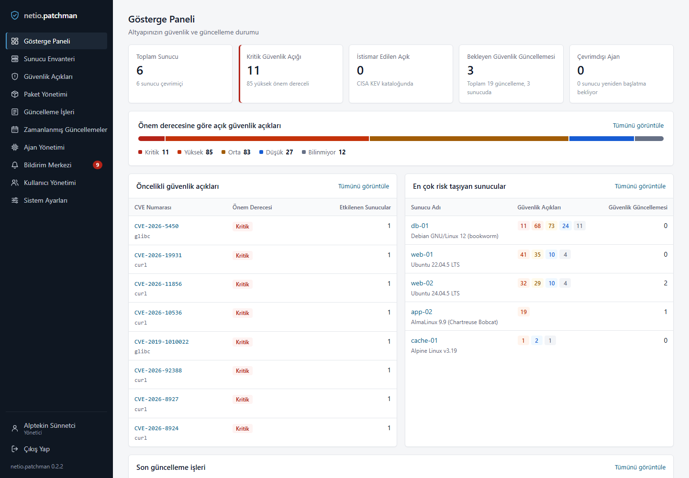
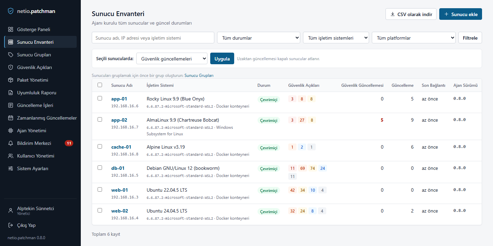
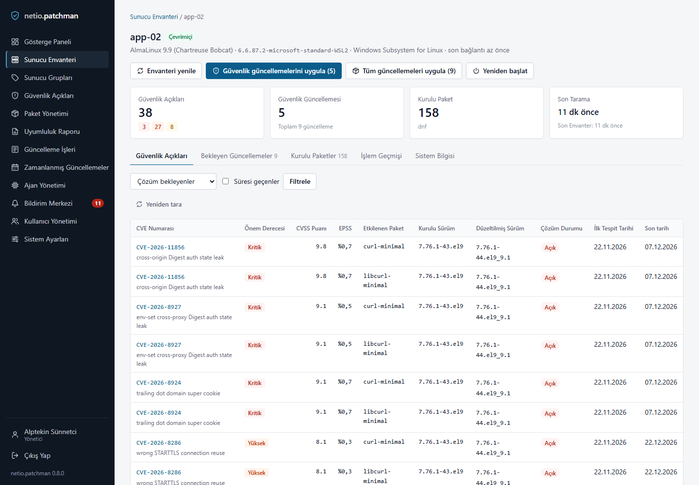
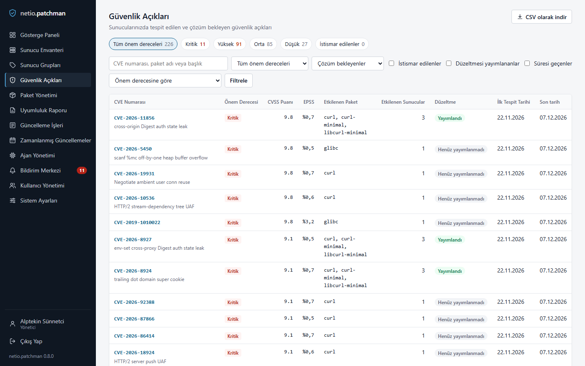
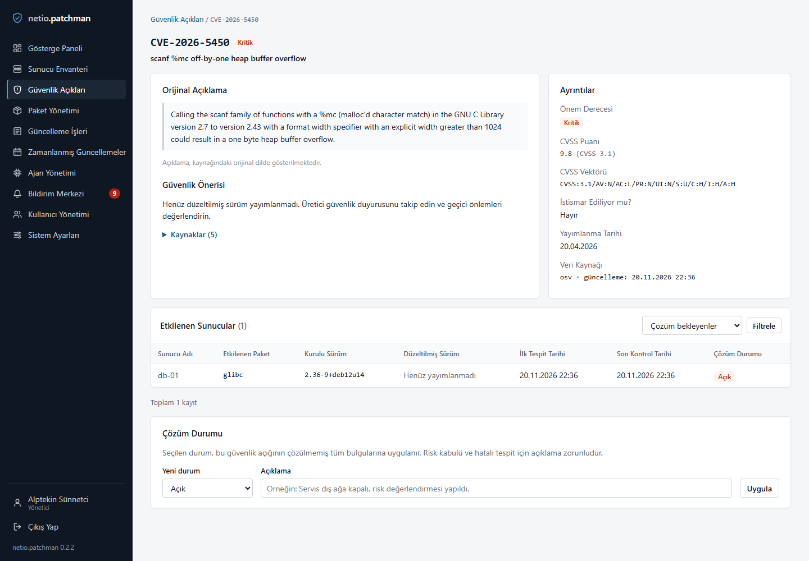
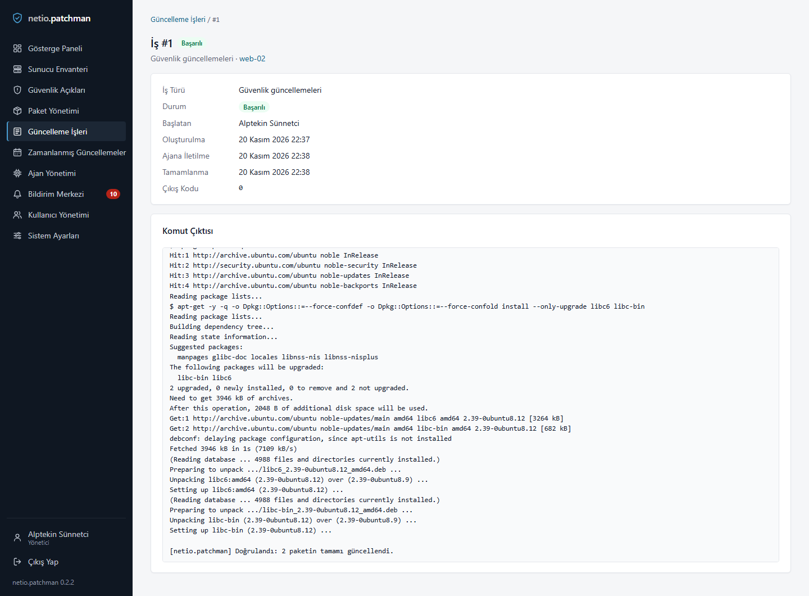
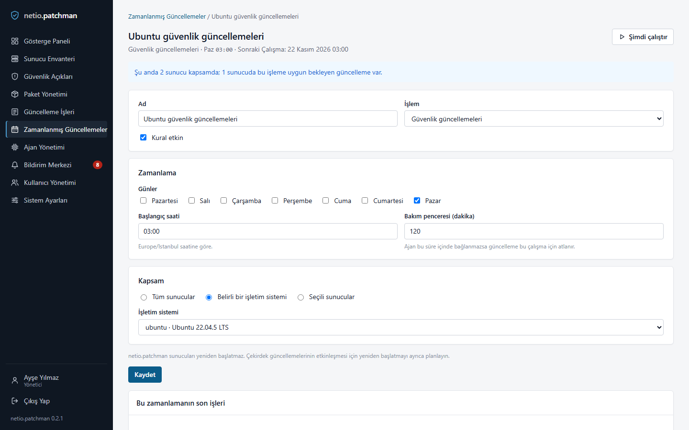
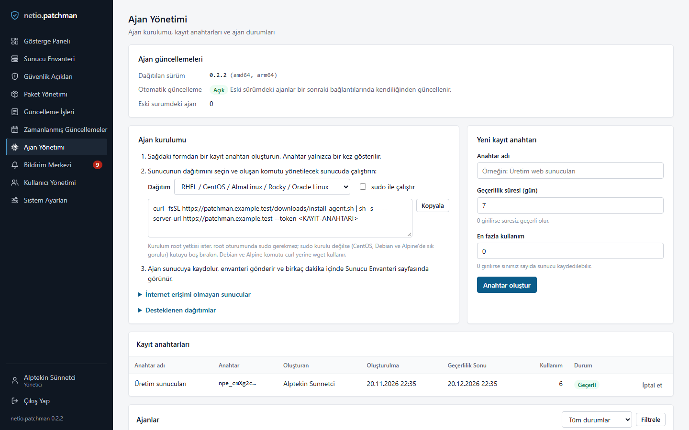
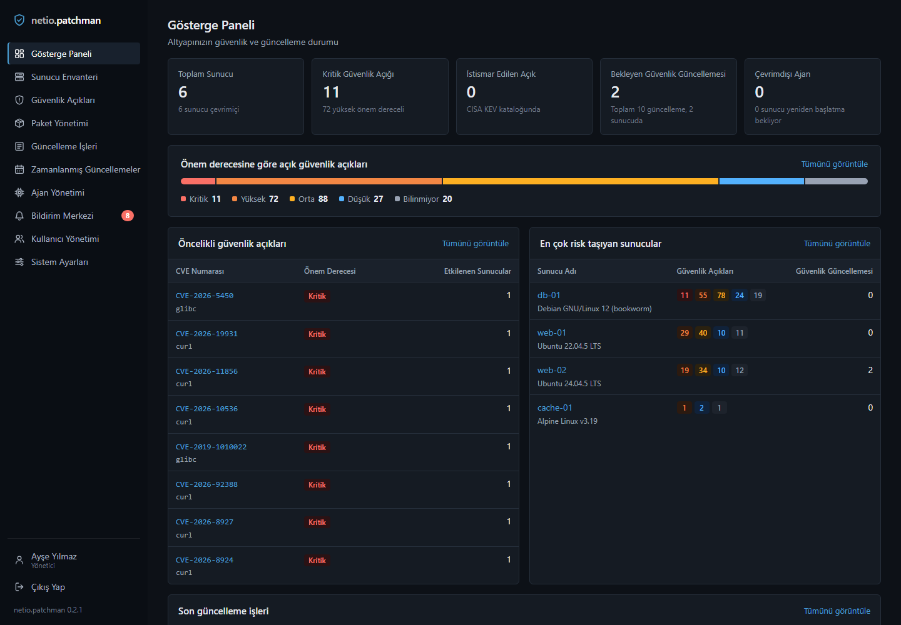

# netio.patchman

**Merkezi Linux ve Windows Güvenlik Açığı ve Güncelleme Yönetimi**

**Türkçe** · [English](README.en.md) · [Deutsch](README.de.md) · [Русский](README.ru.md)

netio.patchman, yüzlerce Linux ve Windows sunucunun güvenlik açıklarını ve paket güncellemelerini tek bir panelden izlemenizi ve yönetmenizi sağlayan, kendi altyapınızda çalışan (self-hosted) bir platformdur.

- Merkezi sunucu tek bir Docker konteyneridir. Gömülü SQLite veritabanı kullanır; ayrı bir veritabanı, kuyruk ya da önbellek servisi gerekmez.
- Yönetilen her sunucuya küçük bir ajan kurulur. Ajan port açmaz; merkezi sunucuya kendisi bağlanır.
- Arayüz Türkçe, İngilizce, Almanca ve Rusçadır; her kullanıcı kendi dilini seçer. E-postalar ve belgeler Türkçedir. CVE verileri kaynağındaki haliyle, çevrilmeden gösterilir.

> **English:** netio.patchman is a self-hosted platform for centralized Linux and Windows vulnerability and update management, with an English web interface. Read the English documentation in [README.en.md](README.en.md). · Deutsch: [README.de.md](README.de.md) · Русский: [README.ru.md](README.ru.md)

> [!WARNING]
> **Kullanım riski tamamen kullanıcıya aittir.** netio.patchman sunucularınızda paket güncelleyen, servisleri ve sunucuyu yeniden başlatan bir yazılımdır. "Olduğu gibi" sunulur ve hiçbir garanti verilmez. Kullanımdan doğabilecek veri kaybı, hizmet kesintisi, başarısız güncelleme, güvenlik açığı ve benzeri her türlü zarardan yazılımı kuran ve kullanan kişi ya da kurum sorumludur. Ayrıntılar: [Sorumluluk reddi](#sorumluluk-reddi).



## İçindekiler

- [Özellikler](#özellikler)
- [Ekran görüntüleri](#ekran-görüntüleri)
- [Nasıl çalışır](#nasıl-çalışır)
- [Kurulum (Docker)](#kurulum-docker)
- [Sunuculara ajan kurulumu](#sunuculara-ajan-kurulumu)
- [Güncelleme, yedekleme ve kaldırma](#güncelleme-yedekleme-ve-kaldırma)
- [Yapılandırma](#yapılandırma)
- [Sorun giderme](#sorun-giderme)
- [Güvenlik](#güvenlik)
- [Geliştirme](#geliştirme)
- [Sorumluluk reddi](#sorumluluk-reddi)
- [Lisans](#lisans)

## Özellikler

- **Sunucu envanteri:** İşletim sistemi, çekirdek, IP adresleri, kurulu paketler, bekleyen güncellemeler, yeniden başlatma ihtiyacı ve eski kodu çalıştıran servisler.
- **Güvenlik açığı taraması:** Kurulu paket sürümleri [OSV.dev](https://osv.dev) üzerinden dağıtımların resmî güvenlik verileriyle eşleştirilir. CVSS puanı, önem derecesi, düzeltilmiş sürüm ve üretici güvenlik duyuruları gösterilir.
- **Aktif istismar bilgisi:** CISA Known Exploited Vulnerabilities (KEV) kataloğundaki açıklar ayrıca işaretlenir ve önceliklendirilir.
- **Windows sunucuları:** Windows Server 2016, 2019, 2022, 2025 ile Windows 10 ve 11 aynı panelden yönetilir. Ajan bir Windows hizmeti olarak çalışır; kurulu programları ve Windows Update'te bekleyen güncellemeleri (KB numarası, başlık, Microsoft önem derecesi, sınıflandırma) bildirir. Bekleyen her KB'nin düzelttiği CVE'ler Microsoft Security Update Guide'dan (MSRC) alınır. Sunucu birkaç ay geride kalmışsa, yerini aldığı eski toplu güncellemelerin CVE'leri de sunucunun Windows derlemesiyle karşılaştırılarak eklenir. Güvenlik güncellemeleri, tüm güncellemeler veya seçili KB'ler panelden kurulur, kurulum doğrulanır; sunucu panelden yeniden başlatılabilir.
- **Merkezi güncelleme:** Panelden tek bir sunucuda, seçilen sunucularda veya tümünde güvenlik güncellemeleri, tüm güncellemeler ya da seçili paketler kurulabilir. Bir CVE için **Düzeltmeyi uygula** ile etkilenen tüm sunucularda ilgili paketler güncellenir. Ajan her işten sonra paketlerin gerçekten güncellendiğini doğrular; güncellenemeyenler listelenir ve tek tıkla yeniden denenebilir.
- **Servis ve sunucu yeniden başlatma:** Güncellenen kütüphaneleri hâlâ eski sürümle kullanan servisler tespit edilir ve panelden yeniden başlatılabilir; sunucu panelden yeniden başlatılabilir.
- **Zamanlanmış güncellemeler:** "Her pazar 03:00'te Ubuntu sunucularında güvenlik güncellemelerini uygula" gibi bakım pencereleri. Zamanlamalar sunucuları kendiliğinden yeniden başlatmaz.
- **Otomatik ajan güncellemesi:** Merkezi sunucu yeni sürüme geçince ajanlar yeni sürümü indirir, SHA-256 özetini doğrular ve kendini günceller.
- **Yeni sürüm bildirimi:** Panel, GitHub'da yeni bir netio.patchman sürümü yayımlandığında yöneticileri uyarır ve güncelleme komutlarını gösterir. İnternet erişimi olmayan kurulumlarda kapatılabilir.
- **Bulgu yönetimi:** Açık, İşlemde, Risk Kabul Edildi, Hatalı Tespit durumları. Paket güncellenince bulgu otomatik olarak "Çözüldü" olur. Risk kabulü süreli verilir (30, 90, 180, 365 gün; en uzun süre ayarlardan sınırlanır). Süre dolunca bulgu yeniden açılır, bildirim ve e-posta gönderilir.
- **Sunucu grupları:** Sunucular "Üretim", "Test", "Veritabanı" gibi gruplara ayrılır. Bir sunucu birden fazla gruba üye olabilir. Listeler gruba göre süzülür, zamanlanmış güncellemeler bir grubu hedefleyebilir, raporlar grup için alınabilir.
- **Platform bilgisi:** Ajan, sunucunun VMware, Hyper-V, KVM, Xen veya VirtualBox sanal makinesi, Docker/LXC konteyneri ya da fiziksel sunucu olduğunu bildirir. Sunucu listesi platforma göre süzülebilir.
- **Yeniden başlatma takibi:** Yeni çekirdek kurulmuş ama sunucu yeniden başlatılmamışsa bu durum ne zamandan beri sürdüğüyle birlikte gösterilir. Gösterge panelinde ayrı bir kart ve süzgeç vardır. Debian'da (`/var/run/reboot-required` dosyası olmayan dağıtımlarda) ve Alpine'de de çekirdek karşılaştırmasıyla tespit edilir.
- **Eğilim grafikleri:** Sunucu her gün filonun durumunu kaydeder. Gösterge panelinde son 30 günün kritik ve yüksek açık sayısı, aktif olarak istismar edilen açıklar, açık bulgular ve bekleyen güvenlik güncellemeleri grafik ve tablo olarak gösterilir.
- **Uyumluluk raporu:** Seçilen dönem ve grup için yazdırılabilir rapor (tarayıcıdan PDF olarak kaydedilebilir). Raporda özet sayılar, dönemde tespit edilen ve kapatılan bulgular, ortalama kapatma süresi, CISA son tarihi geçmiş KEV açıkları, sunucu durumu, kabul edilen riskler (kabul eden kişi ve bitiş tarihiyle) ve güncelleme işleri yer alır. ISO 27001 ve KVKK denetimlerinde kanıt olarak kullanılabilir.
- **İki adımlı doğrulama:** Google Authenticator, Microsoft Authenticator gibi uygulamalarla TOTP kodu ve tek kullanımlık yedek kodlar. Yönetici, iki adımlı doğrulamayı tüm kullanıcılar için zorunlu kılabilir; kaybolan bir telefon için kullanıcının doğrulamasını sıfırlayabilir.
- **Bildirimler:** Bildirim merkezi ve e-posta bildirimleri: yeni açıklar, bağlantısı kesilen ajanlar, başarısız veya kısmen tamamlanan güncelleme işleri.
- **Slack, Microsoft Teams, Telegram ve webhook:** Bildirimler seviyeye göre (bilgi, uyarı, kritik) sohbet kanallarına ve HMAC-SHA256 imzalı JSON webhook ile kendi sistemlerinize (SIEM, olay yönetimi) de gönderilir.
- **Otomatik yedekleme:** Veritabanı her gün belirlenen saatte yedeklenir, en yeni N yedek saklanır. Yedekler panelden indirilebilir; başarısız yedekleme bildirilir.
- **Çok dilli arayüz:** Türkçe, İngilizce, Almanca ve Rusça. Her kullanıcı arayüz dilini seçer; tarih, ondalık ayracı ve CSV biçimi dile uyar.
- **Kullanıcılar ve yetkiler:** Yönetici, Operatör ve İzleyici rolleri; denetim kayıtları.
- **Paneldense yapılandırma:** SMTP, sunucu adresi, saat dilimi, veri kaynakları ve tüm işletim ayarları panelden değiştirilir. Değişiklikler yeniden başlatma gerektirmez.
- **Dışa aktarma:** Sunucu ve güvenlik açığı listeleri Excel uyumlu CSV olarak indirilebilir.

### Desteklenen sistemler

| Sistem | Envanter ve güncelleme | Güvenlik açığı taraması |
|---|---|---|
| Debian, Ubuntu | apt | ✓ |
| AlmaLinux, Rocky Linux, Red Hat Enterprise Linux | dnf / yum | ✓ |
| CloudLinux 8, 9 | dnf | ✓ (AlmaLinux güvenlik verileriyle) |
| SUSE Linux Enterprise, openSUSE Leap | zypper | ✓ |
| Alpine Linux | apk | ✓ |
| CentOS, Oracle Linux, Fedora ve diğer dağıtımlar (dnf, yum, zypper, apt veya apk kullanan) | ✓ | — |
| Windows Server 2016, 2019, 2022, 2025; Windows 10, 11 (x64) | Windows Update | ✓ (bekleyen Microsoft güncellemeleri) |

Ajan amd64 ve arm64 mimarilerinde çalışır. Hizmet yöneticisi olarak systemd veya OpenRC (Alpine) gerekir. Sunucunun fiziksel, sanal (VMware, Hyper-V, KVM/Proxmox) veya bulutta olması fark etmez.

Windows'ta ajan x64 sistemlerde Windows hizmeti olarak çalışır ve Windows Update Agent'ı kullanır; WSUS'a bağlı sunucularda WSUS'ta onaylanan güncellemeler görünür. Windows'ta güvenlik açığı taraması Microsoft güncellemeleriyle sınırlıdır: üçüncü taraf programlar (tarayıcılar, 7-Zip vb.) envanterde listelenir ancak taranmaz. Microsoft'un CVE eşlemesi yayımlamadığı güncellemeler (bazı .NET toplu güncellemeleri gibi) Windows Update'in bildirdiği önem derecesiyle güvenlik güncellemesi olarak gösterilir.

CloudLinux 8 ve 9 AlmaLinux kaynaklarından derlendiği için AlmaLinux güvenlik verileriyle taranır. CloudLinux'a özgü paketler (LVE araçları, alt-php vb.) AlmaLinux verisinde bulunmadığından taranmaz; LVE çekirdeği AlmaLinux çekirdeğinin aynı sürümüyle karşılaştırılır. CloudLinux 7 için güvenlik açığı verisi yoktur.

## Ekran görüntüleri

Görüntüler, Ubuntu, Debian, Rocky Linux, AlmaLinux ve Alpine çalıştıran altı test sunucusundan alınmıştır. Güvenlik açıkları OSV.dev'den gelen gerçek verilerdir.

**Sunucu envanteri:** Tüm sunucular, açık sayıları önem derecesine göre, bekleyen güncellemeler ve ajan durumu. Seçili sunucularda toplu güncelleme başlatılabilir.



**Sunucu ayrıntısı:** Sunucudaki açıklar CVSS puanı, etkilenen paket, kurulu ve düzeltilmiş sürümle listelenir. Güvenlik güncellemeleri, tüm güncellemeler ve yeniden başlatma tek tıkla başlatılır.



**Güvenlik açıkları:** Filoda tespit edilen tüm açıklar; önem derecesine, istismar durumuna ve düzeltme olup olmadığına göre süzülebilir.



**Açık ayrıntısı:** Orijinal açıklama (çevrilmeden), CVSS vektörü, etkilenen sunucular ve çözüm durumu.



**Güncelleme işi:** Ajan komut çıktısını gönderir ve işten sonra paketlerin gerçekten güncellendiğini doğrular.



**Zamanlanmış güncellemeler:** Bakım penceresi; gün, saat, süre ve hedef sunucular (tümü, işletim sistemi veya seçili sunucular).



**Ajan kurulumu:** Dağıtım seçilir, kurulum komutu buna göre oluşur (curl veya wget, root veya sudo).



**Karanlık tema:** Panel, işletim sisteminin açık ya da koyu tema ayarını izler.



## Nasıl çalışır

```
 Yönetilen sunucular                     Merkezi sunucu (Docker)                 Dış kaynaklar
┌──────────────────────┐   HTTPS   ┌──────────────────────────────┐   HTTPS   ┌──────────────┐
│ netio-patchman-agent │ ────────▶ │ netio.patchman               │ ────────▶ │ api.osv.dev  │
│  envanter, işler     │  (giden)  │  panel + API + SQLite        │           │ CISA KEV     │
│  (Linux, Windows)    │           │                              │           │ MSRC         │
└──────────────────────┘           └──────────────────────────────┘           └──────────────┘
                                                 ▲
                                    Tarayıcı ────┘  (yönetim paneli)
```

1. Ajan, belirli aralıklarla merkezi sunucuya bağlanır. Kurulu paketleri ve bekleyen güncellemeleri bildirir, sırada bir iş varsa alır.
2. Merkezi sunucu paket sürümlerini OSV.dev'deki dağıtım güvenlik verileriyle eşleştirir ve bulguları panelde gösterir. Windows sunucularında bekleyen KB'lerin düzelttiği CVE'ler Microsoft Security Update Guide'dan alınır.
3. Paneldeki güncelleme işleri ajanın bir sonraki bağlantısında ajana iletilir. Ajan işi sabit paket yöneticisi komutlarıyla çalıştırır ve sonucu bildirir.

Yönetilen sunucularda gelen bağlantı için port açmanız gerekmez.

## Kurulum (Docker)

### Gereksinimler

- Docker Engine 24 veya üzeri ve Docker Compose v2.24 veya üzeri yüklü bir Linux sunucu.
- `git`.
- **İnternet erişimi:** İlk derlemede Docker imajları ve Go modülleri indirilir. Güvenlik açığı verileri için de `api.osv.dev` ve `www.cisa.gov` adreslerine HTTPS erişimi gerekir. İnternet erişimi olmayan ortamlar için bkz. [docs/kurulum.md](docs/kurulum.md#8-internet-erişimi-olmayan-ortamlar).
- **Önerilen kaynaklar:** 100 sunucuya kadar 1 çekirdek, 1 GB bellek ve 5 GB disk.

Docker yüklü değilse, Docker'ın resmî betiğiyle kurabilirsiniz:

```sh
curl -fsSL https://get.docker.com | sudo sh
```

### 1. Depoyu indirin

```sh
git clone https://github.com/alptekinsunnetci/netio.patchman.git
cd netio.patchman
```

### 2. (İsteğe bağlı) Sunucu adresini belirleyin

Ajanların ve kullanıcıların merkezi sunucuya ulaşacağı adresi `.env` dosyasına yazabilirsiniz:

```sh
cp .env.example .env
nano .env        # PATCHMAN_BASE_URL=https://patchman.your-domain
```

Bu adımı atlarsanız adres `http://localhost:8080` olarak başlar. Kurulumdan sonra panelde **Sistem Ayarları → Sunucu yapılandırması** sayfasından değiştirebilirsiniz. Ajanları kurmadan önce adresin doğru olduğundan emin olun, çünkü kurulum komutu bu adresi kullanır.

### 3. Başlatın

```sh
docker compose up -d --build
```

İlk derleme internet hızına bağlı olarak birkaç dakika sürer. Durumu kontrol edin:

```sh
docker compose ps                 # STATUS sütununda "healthy" görünmeli
docker compose logs -f server     # günlük kayıtları (çıkmak için Ctrl+C)
```

### 4. İlk yönetici hesabını oluşturun

Tarayıcıda `http://<sunucu-adresi>:8080` adresini açın. Veritabanı boş olduğu için **İlk Kurulum** sayfası açılır. Burada yönetici hesabını oluşturun. Bu sayfa yalnızca hiç kullanıcı yokken açılır.

### 5. Temel ayarları yapın

Panelde **Sistem Ayarları → Sunucu yapılandırması** sayfasında:

- **Sunucu adresi:** Ajanların erişeceği dış adres, örneğin `https://patchman.your-domain`.
- **E-posta sunucusu (SMTP):** E-posta bildirimleri için. Aynı sayfadan deneme e-postası gönderebilirsiniz.

Kurulum tamamlandı. Sıradaki adım sunuculara ajan kurmak.

### HTTPS

Ajanlar ve tarayıcılar sunucuya HTTPS ile bağlanmalıdır. Önerilen yöntem, sunucuyu nginx, Caddy veya HAProxy gibi bir ters vekilin arkasına koymaktır. Bu durumda panelde **Ters vekil başlıklarına güven** seçeneğini açın. Örnek yapılandırmalar ve sunucunun TLS'i kendisinin sonlandırması için bkz. [docs/kurulum.md](docs/kurulum.md#3-tls-ve-ters-vekil).

**Port değiştirme:** `.env` dosyasına `PATCHMAN_PUBLISH_PORT=8899` yazın ve `docker compose up -d` komutunu yeniden çalıştırın. Ters vekil aynı makinedeyse `PATCHMAN_PUBLISH_PORT=127.0.0.1:8899` kullanın; panel böylece dışarıya şifresiz HTTP ile açılmaz. Portu `PATCHMAN_HTTP_ADDR` ile değiştirmeyin; o ayar Docker dışı kurulumlar içindir ve Docker Compose'da yok sayılır.

**Plesk:** Alan adının **Apache ve nginx Ayarları → Ek nginx yönergeleri** alanına şunu ekleyin. Plesk'in kendi `location /` bloğuyla çakışmaması için düzenli ifade biçimi kullanılır:

```nginx
location ~ ^/ {
    proxy_pass http://127.0.0.1:8899;
    proxy_set_header Host $host;
    proxy_set_header X-Forwarded-For $proxy_add_x_forwarded_for;
    proxy_set_header X-Forwarded-Proto $scheme;
    client_max_body_size 64m;
}
```

Ardından panelde **Ters vekil başlıklarına güven** seçeneğini açın (veya `.env` içinde `PATCHMAN_TRUST_PROXY=true`).

## Sunuculara ajan kurulumu

1. Panelde **Ajan Yönetimi** sayfasından bir **kayıt anahtarı** oluşturun. Anahtar yalnızca bir kez gösterilir. Süre ve kullanım sınırı verebilirsiniz.
2. Sayfada sunucunun dağıtımını seçin. Komut buna göre oluşur: Debian ve Alpine'de `wget`, diğerlerinde `curl` kullanılır. root olarak bağlanıyorsanız **sudo ile çalıştır** kutusunu boş bırakın (sudo, CentOS, Debian ve Alpine'de çoğu zaman kurulu değildir). Komutu yönetilecek sunucuda çalıştırın. Örnek (root olarak, RHEL/CentOS):

   ```sh
   curl -fsSL https://patchman.your-domain/downloads/install-agent.sh | \
     sh -s -- --server-url https://patchman.your-domain --token <KAYIT-ANAHTARI>
   ```

3. Sunucu birkaç saniye içinde **Sunucu Envanteri** sayfasında görünür ve ilk güvenlik taraması otomatik olarak başlar.

Kurulum betiği şunları yapar:

- Ajanı `/usr/local/bin/netio-patchman-agent` konumuna kurar.
- Yapılandırmayı `/etc/netio-patchman/agent.env` dosyasına yazar.
- Hizmeti başlatır: systemd'de `netio-patchman-agent.service`, OpenRC'de (Alpine) `/etc/init.d/netio-patchman-agent`.

Ajanın durumunu ve kayıtlarını şu komutlarla görebilirsiniz:

```sh
systemctl status netio-patchman-agent
journalctl -u netio-patchman-agent -f
```

Toplu dağıtım (Ansible vb.), çevrimdışı kurulum, ajan seçenekleri ve kaldırma adımları için bkz. [docs/kurulum.md](docs/kurulum.md#4-ajan-kurulumu).

### Windows sunucuları

Ajan Yönetimi sayfasında **Windows / Windows Server (PowerShell)** seçeneğini seçin ve oluşan komutu sunucuda **yönetici olarak** açılan PowerShell veya komut isteminde çalıştırın:

```powershell
powershell -NoProfile -ExecutionPolicy Bypass -Command "[Net.ServicePointManager]::SecurityProtocol = [Net.SecurityProtocolType]::Tls12; & ([scriptblock]::Create((irm 'https://patchman.your-domain/downloads/install-agent.ps1').TrimStart([char]65279))) -ServerUrl 'https://patchman.your-domain' -Token '<KAYIT-ANAHTARI>'"
```

Kurulum betiği ajanı `C:\Program Files\netio-patchman\netio-patchman-agent.exe` konumuna kurar, yapılandırmayı yalnızca SYSTEM ve Administrators'ın erişebildiği `C:\ProgramData\netio-patchman\agent.env` dosyasına yazar ve `netio-patchman-agent` Windows hizmetini (otomatik başlatma, hata durumunda yeniden başlatma) oluşturup başlatır. Kayıtlar `C:\ProgramData\netio-patchman\agent.log` dosyasındadır:

```powershell
Get-Service netio-patchman-agent
Get-Content C:\ProgramData\netio-patchman\agent.log -Tail 50 -Wait
```

İnternet erişimi olmayan sunucularda `install-agent.ps1` ve `netio-patchman-agent-windows-amd64.exe` dosyalarını aynı klasöre kopyalayıp `-Binary` seçeneğini kullanın. Kaldırmak için: `.\install-agent.ps1 -Uninstall`. Ajan Windows Update hizmetine en fazla 6 saatte bir çevrim içi sorar; arada Windows'un kendi son taramasının sonucunu okur.

## Güncelleme, yedekleme ve kaldırma

### Yeni sürüme geçme

```sh
cd netio.patchman
git pull
docker compose up -d --build
```

- Veritabanı şeması açılışta otomatik olarak güncellenir; yine de öncesinde yedek alın.
- Sürüm, depodaki `VERSION` dosyasından okunur.
- **Sistem Ayarları → Ajanlar → Ajanları otomatik olarak güncelle** seçeneği açıksa (varsayılan) ajanlar yeni sürüme kendiliğinden geçer.

### Yedekleme ve geri yükleme

**Otomatik yedekleme** varsayılan olarak açıktır: veritabanı her gün 02:30'da `/data/backups/` dizinine yedeklenir ve en yeni 7 yedek saklanır. Saat, saklanacak yedek sayısı ve kapatma **Sistem Ayarları → Otomatik yedekleme** bölümündedir. Aynı yerde **Şimdi yedek al** düğmesi ve yedekleri indirme bağlantıları bulunur. Yedekler varsayılan olarak veritabanıyla aynı Docker biriminde durur; diskin kaybına karşı onları düzenli olarak başka bir yere kopyalayın ya da `PATCHMAN_BACKUP_DIR` ile ayrı bir diske yazdırın (bkz. [docs/kurulum.md](docs/kurulum.md)).

Elle de tutarlı bir yedek alabilirsiniz:

```sh
docker compose exec server netio-patchman-server backup -out /data/yedek.db
docker compose cp server:/data/yedek.db ./yedek-$(date +%Y%m%d).db
```

Yedekten geri yükleme:

```sh
docker compose stop server
docker compose cp ./yedek-20261120.db server:/data/netio-patchman.db
docker compose start server
```

Veritabanı, `netio-patchman-data` adlı Docker biriminde (`/data/netio-patchman.db`) tutulur. Yedeklerde SMTP parolası da bulunur; yedekleri buna göre koruyun.

### Yönetici parolasını sıfırlama

```sh
docker compose exec server netio-patchman-server reset-password -email yonetici@your-domain
```

Komut yeni bir parola üretip ekrana yazar.

Telefonunu kaybeden bir kullanıcının iki adımlı doğrulamasını panelden (**Kullanıcı Yönetimi → kullanıcı → İki adımlı doğrulamayı sıfırla**) ya da komut satırından kaldırabilirsiniz:

```sh
docker compose exec server netio-patchman-server reset-mfa -email yonetici@your-domain
```

### Kaldırma veya sıfırdan başlama

```sh
docker compose down        # konteyneri durdurur, veriler korunur
docker compose down -v     # konteyneri ve veritabanını siler (geri alınamaz)
```

`down -v` sonrasında `docker compose up -d` ile sistem boş bir veritabanıyla, **İlk Kurulum** adımından başlar.

## Yapılandırma

Yapılandırmanın tamamı yönetim panelinden yapılabilir:

- **Sistem Ayarları:** Bildirim eşikleri ve alıcıları, ajan bağlantı aralıkları, otomatik ajan güncellemesi, tarama, kayıt saklama süresi, güvenlik (iki adımlı doğrulama, risk kabulü süresi) ve otomatik yedekleme.
- **Sistem Ayarları → Bildirim kanalları:** Slack, Microsoft Teams, Telegram ve webhook kanalları.
- **Sistem Ayarları → Sunucu yapılandırması:** Sunucu adresi, ters vekil, saat dilimi, günlük seviyesi, SMTP ve veri kaynakları (OSV, CISA KEV, Microsoft Security Update Guide).

`.env` dosyasındaki `PATCHMAN_` önekli değişkenler yalnızca ilk değerleri verir; panelde kaydedilen değer bunların yerine geçer. Aşağıdaki tabloda "Panelden" sütununda "—" ile işaretli değerler sunucu başlarken gerektiği için yalnızca `.env` ile değiştirilebilir ve yeniden başlatma gerektirir. Tüm seçenekler açıklamalarıyla [.env.example](.env.example) dosyasındadır.

| Değişken | Varsayılan | Açıklama | Panelden |
|---|---|---|---|
| `PATCHMAN_BASE_URL` | `http://localhost:8080` | Panelin ve ajanların kullandığı dış adres | evet |
| `PATCHMAN_PUBLISH_PORT` | `8080` | Docker'ın sunucuda yayınladığı port; `127.0.0.1:8899` biçimi yalnızca yerel arabirimde yayınlar | — |
| `PATCHMAN_HTTP_ADDR` | `:8080` | Yalnızca Docker dışı kurulumlarda dinleme adresi; Docker Compose'da sabit `:8080` | — |
| `PATCHMAN_TRUST_PROXY` | `false` | Ters vekil arkasında istemci IP'sini `X-Forwarded-For` başlığından al | evet |
| `PATCHMAN_TLS_CERT_FILE`, `PATCHMAN_TLS_KEY_FILE` | — | Sunucunun TLS'i kendisinin sonlandırması için sertifika ve anahtar | — |
| `PATCHMAN_TIMEZONE` | `Europe/Istanbul` | Tarih ve saatlerin gösterildiği saat dilimi | evet |
| `PATCHMAN_LOCALE` | `tr-TR` | Varsayılan dil (`tr-TR`, `en-US`, `de-DE` veya `ru-RU`): yeni kullanıcıların arayüzü, e-postalar ve günlükler. Her kullanıcı kendi arayüz dilini ayrıca seçebilir | — |
| `PATCHMAN_BACKUP_DIR` | `/data/backups` | Otomatik yedeklerin yazıldığı dizin | — |
| `PATCHMAN_OSV_URL` | `https://api.osv.dev` | OSV API adresi (iç ağ yansısı kullanılabilir) | evet |
| `PATCHMAN_KEV_URL` | CISA KEV adresi | KEV kataloğu adresi; `off` ile kapatılır | evet |
| `PATCHMAN_MSRC_URL` | `https://api.msrc.microsoft.com/sug/v2.0/en-US` | Windows sunucularının CVE eşlemesi için Microsoft Security Update Guide adresi; `off` ile kapatılır | evet |
| `PATCHMAN_SMTP_HOST`, `PATCHMAN_SMTP_PORT` | —, `587` | E-posta sunucusu | evet |
| `PATCHMAN_SMTP_USERNAME`, `PATCHMAN_SMTP_PASSWORD` | — | SMTP kimlik bilgileri | evet |
| `PATCHMAN_SMTP_FROM_NAME`, `PATCHMAN_SMTP_FROM_ADDRESS` | `netio.patchman`, — | Gönderen adı ve adresi | evet |
| `PATCHMAN_LOG_LEVEL`, `PATCHMAN_LOG_FORMAT` | `info`, `json` | Günlük seviyesi ve biçimi | seviye: evet, biçim: — |
| `PATCHMAN_VERSION` | `VERSION` dosyası | Derlenen sunucu ve ajan sürümü | — |

Ortam değişkenlerinde hatalı bir değer varsa sunucu başlamaz ve hataları Türkçe olarak listeler.

## Sorun giderme

| Belirti | Kontrol |
|---|---|
| Panel açılmıyor | `docker compose ps` çıktısının PORTS sütununda `0.0.0.0:<port>->8080/tcp` görünmeli. `docker compose logs server` ile hataları görün. Güvenlik duvarında `PATCHMAN_PUBLISH_PORT` portu açık mı? |
| Kurulum komutu `localhost` adresini gösteriyor | **Sunucu yapılandırması** sayfasında sunucu adresini ajanların erişebileceği adresle değiştirin. |
| Ajan kaydolmuyor | Ajanın bulunduğu sunucudan `curl -I https://patchman.your-domain/healthz` çalışıyor mu? `journalctl -u netio-patchman-agent -n 50` |
| Windows ajanı kaydolmuyor veya güncelleme göstermiyor | `Get-Content C:\ProgramData\netio-patchman\agent.log -Tail 50`. Windows Update hizmeti (`wuauserv`) devre dışı mı? Sunucu WSUS'a bağlıysa güncellemeler WSUS'ta onaylanmış mı? |
| Windows sunucusunda CVE görünmüyor | Merkezi sunucu `api.msrc.microsoft.com` adresine erişebiliyor mu? **Sunucu yapılandırması** sayfasında Microsoft Security Update Guide açık mı? |
| Açık taraması sonuç vermiyor | Merkezi sunucunun `api.osv.dev` adresine erişimi var mı? Günlüklerde OSV hatası arayın. |
| E-posta gelmiyor | **Sunucu yapılandırması** sayfasından deneme e-postası gönderin; hata mesajı panelde gösterilir. |

Ayrıntılı bilgi: [docs/kurulum.md](docs/kurulum.md) (kurulum ve işletim), [docs/kullanim.md](docs/kullanim.md) (panel kullanımı).

## Dil ve yerelleştirme

- Varsayılan dil Türkçedir (`tr-TR`). Arayüz İngilizce (`en-US`), Almanca (`de-DE`) ve Rusça (`ru-RU`) olarak da kullanılabilir: giriş ekranındaki dil bağlantıları veya **Profilim → Arayüz dili**. Seçim kullanıcıya kaydedilir ve diğer cihazlarda da geçerli olur.
- E-postalar, sohbet kanalı mesajları ve sistem günlükleri sunucunun varsayılan dilindedir (`PATCHMAN_LOCALE`). Ajan mesajlarının dili ajan kurulurken `--locale` ile seçilir (ör. `--locale de-DE`); panel Türkçe dışındaki bir dildeyken kurulum komutu bu seçeneği kendisi ekler.
- Tarihler Türkçe, Almanca ve Rusçada `21.11.2026`, İngilizcede `2026-11-21` biçimindedir. CSV dosyaları İngilizcede `,`, diğer dillerde `;` ile ayrılır.
- **Güvenlik açığı verileri çevrilmez.** CVE numaraları, resmî başlıklar, açıklamalar, CVSS değerleri, paket adları ve üretici duyuruları kaynağında yayımlandığı haliyle gösterilir.
- Zaman bilgileri UTC olarak saklanır ve seçilen saat diliminde (varsayılan `Europe/Istanbul`) gösterilir.
- Arayüz metinleri `internal/i18n/locales/` altındadır. Yeni bir dil, aynı anahtarlarla yeni bir dosya eklenerek desteklenir.

## Güvenlik

- Parolalar PBKDF2-SHA256 (600.000 tekrar) ile saklanır. Oturum, kayıt anahtarı ve ajan kimlikleri veritabanında yalnızca SHA-256 özeti olarak tutulur.
- Tüm form işlemleri CSRF korumalıdır. Başarısız girişler IP ve hesap bazında sınırlandırılır.
- Ajan port açmaz ve dışarıdan bağlantı kabul etmez. Yalnızca önceden tanımlı paket yöneticisi komutlarını, kabuk kullanmadan çalıştırır; paket adları her iki tarafta doğrulanır. Windows'ta Windows Update, ajana gömülü sabit bir PowerShell betiğiyle (Windows Update Agent API) kullanılır; KB adları da doğrulanır.
- Bir sunucuda uzaktan güncellemeyi tamamen kapatmak için o sunucunun `/etc/netio-patchman/agent.env` dosyasına `PATCHMAN_REMOTE_UPDATES=false` yazın. Windows'ta aynı ayar `C:\ProgramData\netio-patchman\agent.env` dosyasındadır.
- Panel katı bir Content-Security-Policy ile sunulur ve dış kaynak (CDN, yazı tipi) kullanmaz; internet erişimi olmayan ağlarda da çalışır.

## Geliştirme

Gereksinim: Go 1.26 veya üzeri.

```sh
go test ./...                                   # birim ve uçtan uca testler
go vet ./...
PATCHMAN_DATA_DIR=./data go run ./cmd/netio-patchman-server

# Ajan dosyalarını sunucunun dağıtım biçiminde dist/agent/ altına derleme
scripts/build-agent.sh                                    # Linux / macOS
powershell -File scripts\build-agent.ps1                  # Windows

# OSV.dev ve Microsoft Security Update Guide'a karşı canlı tarama testi (internet erişimi gerekir)
go test -tags live -run Live -v ./internal/scanner/

# Windows'ta gerçek Windows Update taraması (yalnızca arar, bir şey kurmaz)
go test -tags live -run LiveWindows -v ./internal/agent/
```

Ürün gereksinimleri [docs/spec/](docs/spec/) dizinindedir.

## Sorumluluk reddi

netio.patchman "olduğu gibi" (AS IS) sunulur. Açık ya da örtülü hiçbir garanti verilmez: ticari elverişlilik, belirli bir amaca uygunluk, hatasız ya da kesintisiz çalışma ve güvenlik açıklarının eksiksiz tespiti dahil.

**Yazılımın kurulmasından ve kullanılmasından doğabilecek tüm riskler ve sonuçlar, yazılımı kuran ve kullanan kişi ya da kuruma aittir.** Geliştirici, yürürlükteki hukukun izin verdiği en geniş ölçüde, doğrudan ya da dolaylı hiçbir zarardan sorumlu tutulamaz. Bu zararlar şunları kapsar:

- Paket güncellemesi, servis veya sunucu yeniden başlatma sırasında ya da sonrasında oluşan hizmet kesintileri, uyumsuzluklar ve veri kaybı.
- Başarısız, yarım kalan veya beklenmeyen sonuç veren güncelleme işleri ve zamanlanmış güncellemeler.
- Tespit edilemeyen, yanlış tespit edilen veya önem derecesi hatalı gösterilen güvenlik açıkları. Güvenlik verileri üçüncü taraf kaynaklardan (OSV.dev, CISA KEV, Microsoft Security Update Guide, dağıtım duyuruları) gelir; doğrulukları bu kaynaklara bağlıdır.
- Yazılımın, ajanların veya merkezi sunucunun yanlış yapılandırılması, yetkisiz erişime açık bırakılması ya da kötüye kullanılması.

Kullanmadan önce:

- Yazılımı önce üretim dışı bir ortamda deneyin.
- Güncellemelerden önce sunucularınızın ve netio.patchman veritabanının yedeğini alın.
- Kritik sunucularda güncellemeleri bakım pencerelerinde ve kontrollü olarak uygulayın.
- Merkezi sunucuyu yalnızca HTTPS ile ve güvenilir ağlardan erişilebilir şekilde yayınlayın.

Bu yazılımı kurmanız ve kullanmanız, bu koşulları kabul ettiğiniz anlamına gelir.

## Lisans

Geliştirici: **Alptekin Sünnetci**. Copyright © 2026 Alptekin Sünnetci.

netio.patchman, [Apache License 2.0](https://www.apache.org/licenses/LICENSE-2.0) ve **Commons Clause** koşulu ile lisanslanmıştır. Tam metin: [LICENSE](LICENSE).

- **İzin verilenler:** Yazılımı ücretsiz kullanmak (kendi altyapınızda, kurum içinde de), incelemek, değiştirmek ve ücretsiz olarak dağıtmak.
- **İzin verilmeyen:** Yazılımı ya da değerinin tamamı veya önemli bir kısmı bu yazılımdan gelen bir ürün veya hizmeti üçüncü kişilere ücret karşılığı sunmak. Satış, ücretli barındırma ve ücretli danışmanlık/destek hizmeti buna dahildir.
- Dağıttığınız kopyalarda LICENSE dosyası ve telif bildirimi korunmalıdır.

Ticari kullanım için geliştiriciyle iletişime geçin.

Lisans metninin bağlayıcı hali İngilizce olan [LICENSE](LICENSE) dosyasıdır; bu bölüm yalnızca özet niteliğindedir.
