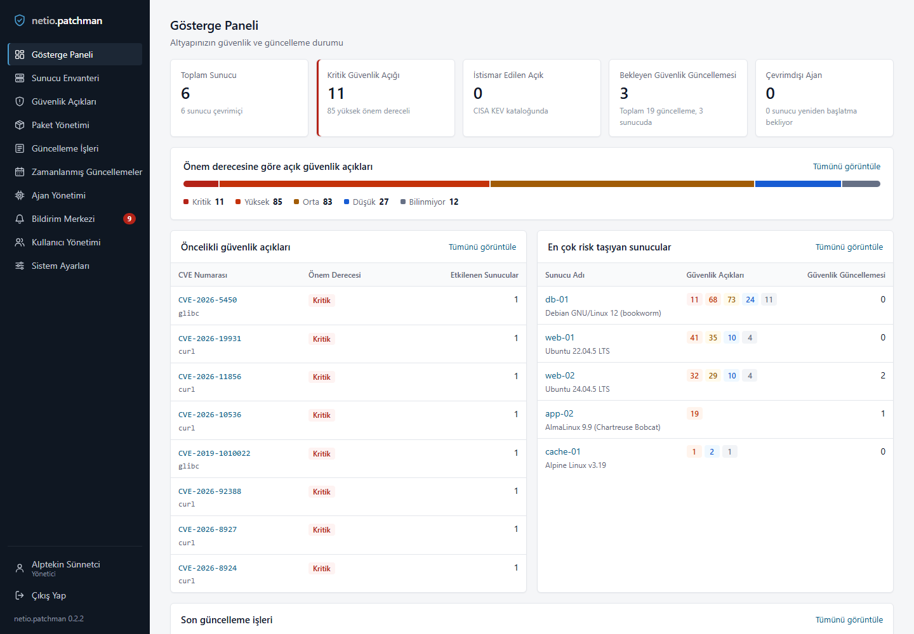
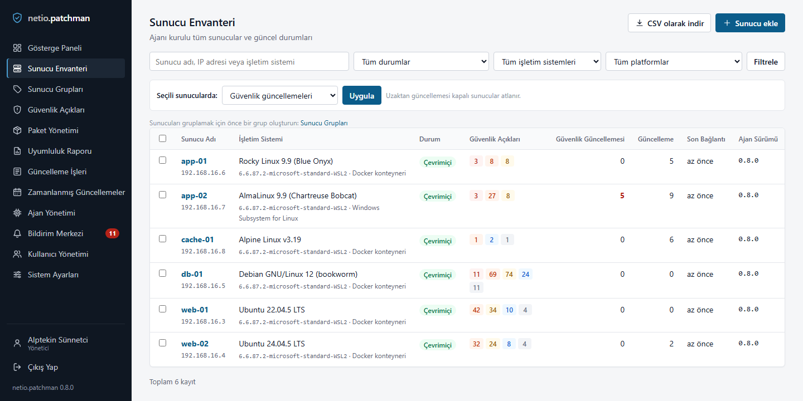
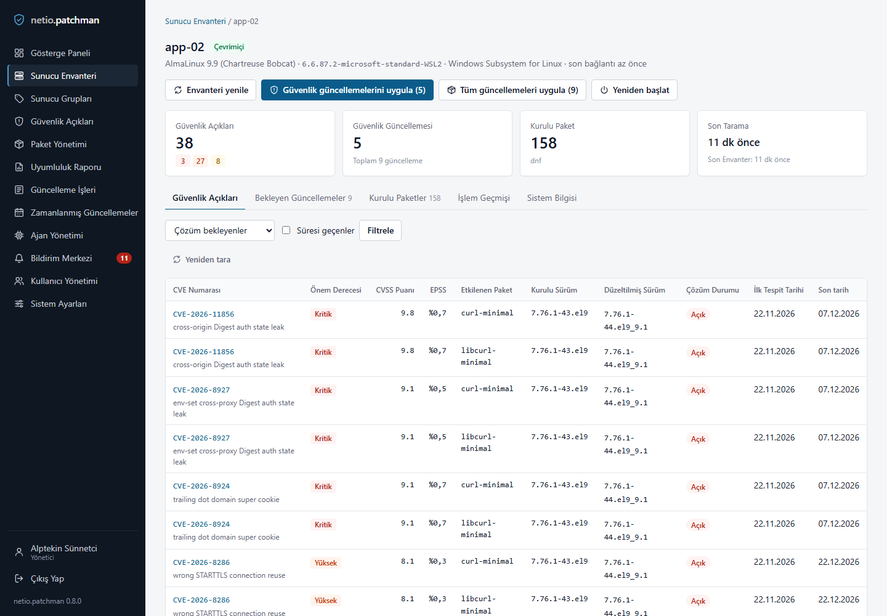
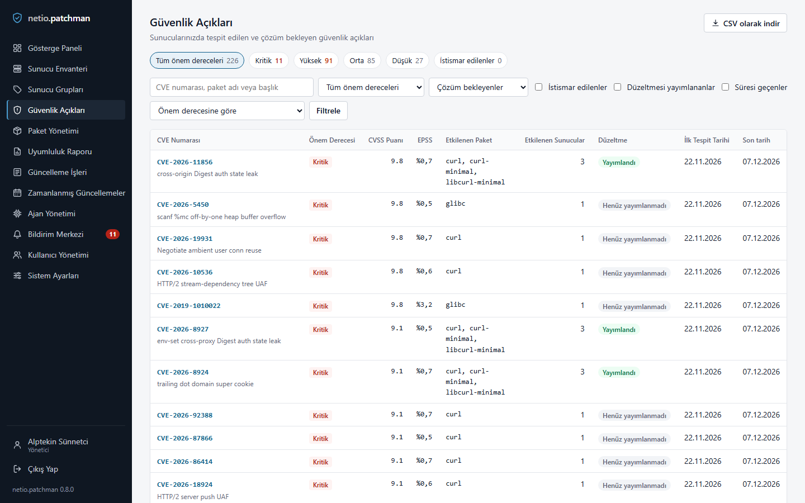
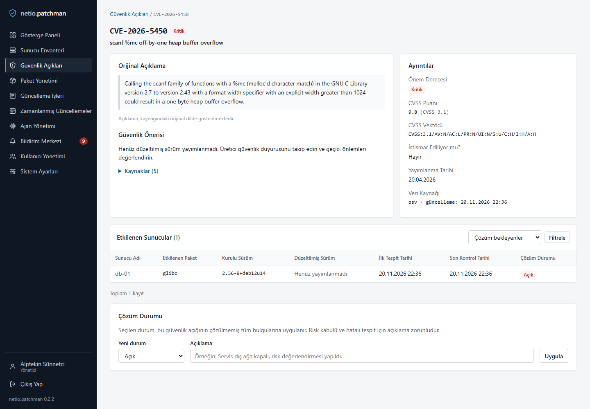
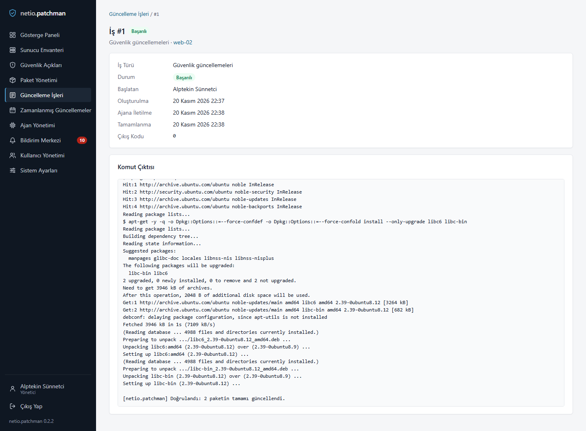
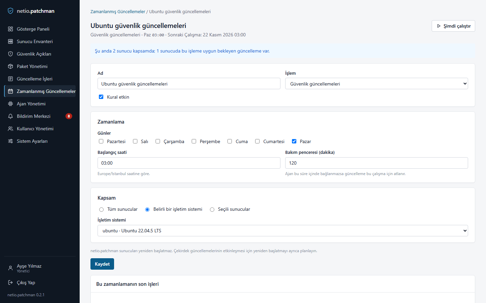
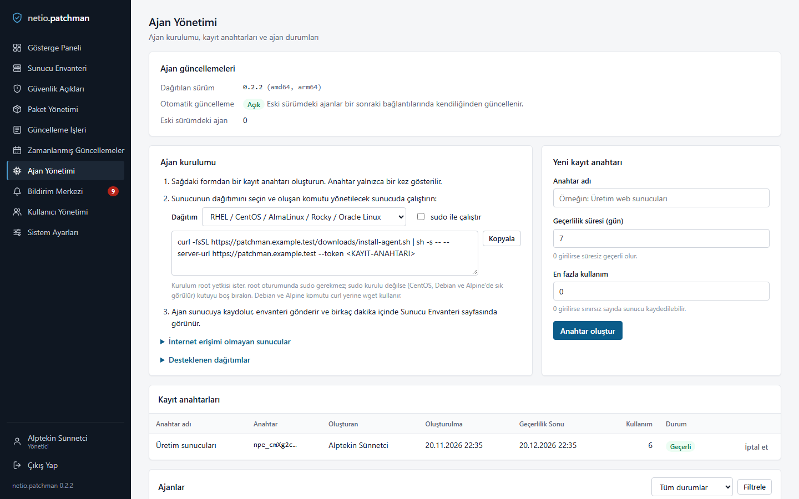

# netio.patchman

**Централизованное управление уязвимостями и обновлениями Linux**

[Türkçe](README.md) · [English](README.en.md) · [Deutsch](README.de.md) · **Русский**

netio.patchman — самостоятельно размещаемая (self-hosted) платформа для мониторинга и управления уязвимостями и обновлениями пакетов сотен серверов Linux из одной панели.

- Центральный сервер — это один контейнер Docker со встроенной базой данных SQLite. Отдельные службы базы данных, очередей или кэша не нужны.
- На каждый управляемый сервер устанавливается небольшой агент. Агент не открывает портов; он сам подключается к центральному серверу.
- Веб-интерфейс доступен на турецком, английском, немецком и русском языках; каждый пользователь выбирает свой язык. Данные CVE показываются в том виде, в каком их опубликовал источник, и никогда не переводятся.

> [!WARNING]
> **Вы используете это программное обеспечение полностью на свой страх и риск.** netio.patchman обновляет пакеты, перезапускает службы и перезагружает серверы. ПО предоставляется «как есть», без каких-либо гарантий. Ответственность за любой ущерб от использования, включая потерю данных, перерывы в работе служб, неудачные обновления и уязвимости, несёт лицо или организация, которые устанавливают и используют ПО. Подробнее: [Отказ от ответственности](#отказ-от-ответственности).



## Содержание

- [Возможности](#возможности)
- [Снимки экрана](#снимки-экрана)
- [Как это работает](#как-это-работает)
- [Установка (Docker)](#установка-docker)
- [Установка агента на серверы](#установка-агента-на-серверы)
- [Обновление, резервное копирование и удаление](#обновление-резервное-копирование-и-удаление)
- [Настройка](#настройка)
- [Устранение неполадок](#устранение-неполадок)
- [Язык и локализация](#язык-и-локализация)
- [Безопасность](#безопасность)
- [Разработка](#разработка)
- [Отказ от ответственности](#отказ-от-ответственности)
- [Лицензия](#лицензия)

## Возможности

- **Инвентарь серверов:** операционная система, ядро, IP-адреса, установленные пакеты, ожидающие обновления, необходимость перезагрузки и службы, всё ещё выполняющие старый код.
- **Сканирование уязвимостей:** версии установленных пакетов сопоставляются с официальными данными безопасности дистрибутивов через [OSV.dev](https://osv.dev). Показываются оценка CVSS, важность, исправленная версия и бюллетени производителей.
- **Известные эксплуатируемые уязвимости:** уязвимости из каталога CISA Known Exploited Vulnerabilities (KEV) отмечаются и получают приоритет.
- **Централизованные обновления:** устанавливайте обновления безопасности, все обновления или выбранные пакеты на одном, нескольких выбранных или всех серверах прямо из панели. Кнопка **Применить исправление** для CVE обновляет соответствующие пакеты на всех затронутых серверах. После каждого задания агент проверяет, что пакеты действительно обновлены; необновлённые пакеты перечисляются, и их можно повторить одним нажатием.
- **Перезапуск служб и серверов:** службы, которые всё ещё используют старые версии обновлённых библиотек, обнаруживаются и могут быть перезапущены из панели; серверы можно перезагружать из панели.
- **Плановые обновления:** окна обслуживания вида «каждое воскресенье в 03:00 устанавливать обновления безопасности на серверах Ubuntu». Расписания никогда сами не перезагружают серверы.
- **Автоматическое обновление агентов:** когда центральный сервер переходит на новую версию, агенты загружают её, проверяют контрольную сумму SHA-256 и обновляются сами.
- **Уведомление о новой версии:** панель сообщает администраторам о выходе новой версии netio.patchman на GitHub и показывает команды обновления. Для установок без доступа в интернет можно отключить.
- **Работа с находками:** состояния «Открыта», «В работе», «Риск принят», «Ложное срабатывание». После обновления пакета находка автоматически становится «Устранена». Риск принимается на ограниченный срок (30, 90, 180 или 365 дней; максимум задаётся в настройках). По истечении срока находка снова открывается, отправляются уведомление и письмо.
- **Группы серверов:** разделите серверы на группы, например «Рабочие», «Тестовые» или «Базы данных». Сервер может входить в несколько групп. Списки фильтруются по группе, плановые обновления могут нацеливаться на группу, отчёты можно формировать по группе.
- **Сведения о платформе:** агент сообщает, является ли сервер виртуальной машиной (VMware, Hyper-V, KVM, Xen, VirtualBox), контейнером Docker/LXC или физическим сервером. Список серверов фильтруется по платформе.
- **Отслеживание перезагрузок:** если установлено новое ядро, а сервер не перезагружен, это показывается вместе со временем ожидания. На панели для этого есть отдельная карточка и фильтр. В Debian (без `/var/run/reboot-required`) и Alpine это также определяется сравнением ядер.
- **Графики динамики:** сервер ежедневно сохраняет состояние парка. Панель показывает за последние 30 дней критические и высокие уязвимости, активно эксплуатируемые уязвимости, открытые находки и ожидающие обновления безопасности в виде графиков и таблицы.
- **Отчёт о соответствии:** печатный отчёт (в браузере можно сохранить в PDF) за выбранный период и группу: сводные показатели, находки, обнаруженные и устранённые за период, среднее время устранения, уязвимости KEV с истёкшим сроком CISA, состояние серверов, принятые риски (с указанием, кто принял и до какого срока) и задания обновления. Подходит в качестве доказательств для аудитов ISO 27001 и аналогичных.
- **Двухфакторная аутентификация:** коды TOTP из приложений вроде Google Authenticator или Microsoft Authenticator и одноразовые резервные коды. Администратор может сделать её обязательной для всех и сбросить для пользователя, потерявшего телефон.
- **Уведомления:** центр уведомлений и письма о новых уязвимостях, отключившихся агентах, неудачных или частично выполненных заданиях обновления.
- **Slack, Microsoft Teams, Telegram и webhook:** уведомления с фильтром по уровню (информация, предупреждение, критично) отправляются также в чаты и через JSON-webhook с подписью HMAC-SHA256 в ваши системы (SIEM, управление инцидентами).
- **Автоматическое резервное копирование:** база данных ежедневно копируется в заданное время, хранятся N последних копий. Копии можно скачать из панели; о неудачном копировании сообщается.
- **Многоязычный интерфейс:** турецкий, английский, немецкий и русский. Каждый пользователь выбирает язык; формат даты, десятичный разделитель и формат CSV следуют языку.
- **Пользователи и роли:** роли «Администратор», «Оператор» и «Наблюдатель»; журнал аудита.
- **Настройка из панели:** SMTP, адрес сервера, часовой пояс, источники данных и все рабочие параметры меняются в панели. Изменения применяются без перезапуска.
- **Экспорт:** списки серверов и уязвимостей можно скачать в CSV, совместимом с Excel.

### Поддерживаемые дистрибутивы

| Дистрибутив | Инвентарь и обновления | Сканирование уязвимостей |
|---|---|---|
| Debian, Ubuntu | apt | ✓ |
| AlmaLinux, Rocky Linux, Red Hat Enterprise Linux | dnf / yum | ✓ |
| SUSE Linux Enterprise, openSUSE Leap | zypper | ✓ |
| Alpine Linux | apk | ✓ |
| CentOS, Oracle Linux, Fedora и другие дистрибутивы (с dnf, yum, zypper, apt или apk) | ✓ | — |

Агент работает на amd64 и arm64. В качестве менеджера служб нужен systemd или OpenRC (Alpine). Поддерживаются физические, виртуальные (VMware, Hyper-V, KVM/Proxmox) и облачные серверы.

## Снимки экрана

На снимках показан турецкий интерфейс; на других языках расположение элементов то же. Снимки сделаны на шести тестовых серверах с Ubuntu, Debian, Rocky Linux, AlmaLinux и Alpine. Уязвимости — реальные данные OSV.dev.

**Инвентарь серверов:** все серверы с уязвимостями по важности, ожидающими обновлениями и состоянием агента. На выбранных серверах можно запустить массовое обновление.



**Сведения о сервере:** уязвимости сервера с оценкой CVSS, затронутым пакетом, установленной и исправленной версией. Обновления безопасности, все обновления и перезагрузка запускаются одним нажатием.



**Уязвимости:** все найденные в парке уязвимости с фильтрами по важности, эксплуатации и наличию исправления.



**Сведения об уязвимости:** исходное (непереведённое) описание, вектор CVSS, затронутые серверы и состояние.



**Задание обновления:** агент передаёт вывод команды и после задания проверяет, что пакеты действительно обновлены.



**Плановые обновления:** окно обслуживания с днями, временем, длительностью и целевыми серверами (все, операционная система, группа или выбранные серверы).



**Установка агента:** выберите дистрибутив — команда установки формируется для него (curl или wget, root или sudo).



**Тёмная тема:** панель следует светлой или тёмной теме операционной системы.


## Как это работает

```
 Управляемые серверы                     Центральный сервер (Docker)             Внешние источники
┌──────────────────────┐   HTTPS   ┌──────────────────────────────┐   HTTPS   ┌──────────────┐
│ netio-patchman-agent │ ────────▶ │ netio.patchman               │ ────────▶ │ api.osv.dev  │
│  инвентарь, задания  │ (исходящ.)│  панель + API + SQLite       │           │ CISA KEV     │
└──────────────────────┘           └──────────────────────────────┘           └──────────────┘
                                                 ▲
                                     Браузер ────┘  (панель управления)
```

1. Агент регулярно подключается к центральному серверу. Он сообщает об установленных пакетах и ожидающих обновлениях и забирает задание, если оно есть.
2. Центральный сервер сопоставляет версии пакетов с данными безопасности дистрибутивов на OSV.dev и показывает находки в панели.
3. Задания обновления из панели передаются агенту при следующем подключении. Агент выполняет их фиксированными командами менеджера пакетов и сообщает результат.

Открывать входящие порты на управляемых серверах не нужно.

## Установка (Docker)

### Требования

- Сервер Linux с Docker Engine 24 или новее и Docker Compose v2.24 или новее.
- `git`.
- **Доступ в интернет:** при первой сборке загружаются образы Docker и модули Go. Для данных об уязвимостях также нужен доступ по HTTPS к `api.osv.dev` и `www.cisa.gov`. Для сред без доступа в интернет см. [docs/kurulum.md](docs/kurulum.md#8-internet-erişimi-olmayan-ortamlar) (на турецком).
- **Рекомендуемые ресурсы:** до 100 серверов: 1 ядро CPU, 1 ГБ ОЗУ и 5 ГБ диска.

Если Docker не установлен, его можно установить официальным сценарием Docker:

```sh
curl -fsSL https://get.docker.com | sudo sh
```

### 1. Загрузите репозиторий

```sh
git clone https://github.com/alptekinsunnetci/netio.patchman.git
cd netio.patchman
```

### 2. (Необязательно) Укажите адрес сервера и язык

Запишите в файл `.env` адрес, по которому агенты и пользователи будут обращаться к центральному серверу. Чтобы сделать русский языком по умолчанию (для новых пользователей, писем, сообщений в чаты и журналов), также задайте `PATCHMAN_LOCALE`:

```sh
cp .env.example .env
nano .env        # PATCHMAN_BASE_URL=https://patchman.your-domain
                 # PATCHMAN_LOCALE=ru-RU
```

Если пропустить этот шаг, адрес будет `http://localhost:8080`. После установки его можно изменить в разделе **Настройки → Конфигурация сервера**. Проверьте адрес до установки агентов, так как команда установки использует его.

### 3. Запустите

```sh
docker compose up -d --build
```

Первая сборка занимает несколько минут в зависимости от скорости соединения. Проверьте состояние:

```sh
docker compose ps                 # в столбце STATUS должно быть "healthy"
docker compose logs -f server     # журналы (выход — Ctrl+C)
```

### 4. Создайте первую учётную запись администратора

Откройте в браузере `http://<адрес-сервера>:8080`. Поскольку база данных пуста, откроется страница **Первоначальная настройка**. Переключите язык ссылкой **Русский** внизу страницы и создайте учётную запись администратора. Эта страница доступна только пока нет ни одного пользователя.

### 5. Основные настройки

В панели в разделе **Настройки → Конфигурация сервера**:

- **Адрес сервера:** внешний адрес для агентов, например `https://patchman.your-domain`.
- **Почтовый сервер (SMTP):** для уведомлений по почте. На той же странице можно отправить тестовое письмо.

Установка завершена. Следующий шаг — установка агента на серверы.

### HTTPS

Агенты и браузеры должны подключаться к серверу по HTTPS. Рекомендуется поставить перед сервером обратный прокси, например nginx, Caddy или HAProxy. В этом случае включите в панели параметр **Доверять заголовкам X-Forwarded-For и X-Forwarded-Proto обратного прокси**. Примеры конфигураций и завершение TLS на самом сервере: см. [docs/kurulum.md](docs/kurulum.md#3-tls-ve-ters-vekil) (на турецком).

**Смена порта:** укажите `PATCHMAN_PUBLISH_PORT=8899` в `.env` и снова выполните `docker compose up -d`. Если обратный прокси работает на той же машине, используйте `PATCHMAN_PUBLISH_PORT=127.0.0.1:8899`, чтобы панель не была доступна снаружи по незашифрованному HTTP. Не меняйте порт через `PATCHMAN_HTTP_ADDR`: этот параметр предназначен для установок без Docker и игнорируется Docker Compose.

**Plesk:** добавьте в разделе домена **Настройки Apache и nginx → Дополнительные директивы nginx** следующий блок. Форма с регулярным выражением исключает конфликт с собственным блоком `location /` Plesk:

```nginx
location ~ ^/ {
    proxy_pass http://127.0.0.1:8899;
    proxy_set_header Host $host;
    proxy_set_header X-Forwarded-For $proxy_add_x_forwarded_for;
    proxy_set_header X-Forwarded-Proto $scheme;
    client_max_body_size 64m;
}
```

Затем включите в панели параметр обратного прокси (или задайте `PATCHMAN_TRUST_PROXY=true` в `.env`).

## Установка агента на серверы

1. На странице **Агенты** создайте **ключ регистрации**. Ключ показывается только один раз. Можно задать срок действия и лимит использований.
2. Выберите на странице дистрибутив сервера. Команда формируется для него: `wget` в Debian и Alpine, `curl` в остальных. Если вы подключены как root, оставьте флажок **Выполнить через sudo** снятым (sudo часто не установлен в CentOS, Debian и Alpine). Если панель на русском, команда содержит `--locale ru-RU`, чтобы и сообщения агента были на русском. Выполните команду на управляемом сервере. Пример (от root, RHEL/CentOS):

   ```sh
   curl -fsSL https://patchman.your-domain/downloads/install-agent.sh | \
     sh -s -- --server-url https://patchman.your-domain --token <КЛЮЧ-РЕГИСТРАЦИИ> --locale ru-RU
   ```

3. Через несколько секунд сервер появится в **Инвентаре серверов**, и автоматически начнётся первое сканирование уязвимостей.

Сценарий установки:

- устанавливает агент в `/usr/local/bin/netio-patchman-agent`,
- записывает конфигурацию в `/etc/netio-patchman/agent.env`,
- запускает службу: `netio-patchman-agent.service` в systemd, `/etc/init.d/netio-patchman-agent` в OpenRC (Alpine).

Сценарий установки выводит сообщения на турецком языке.

Состояние и журналы агента:

```sh
systemctl status netio-patchman-agent
journalctl -u netio-patchman-agent -f
```

Массовое развёртывание (Ansible и др.), установка без интернета, параметры агента и удаление: см. [docs/kurulum.md](docs/kurulum.md#4-ajan-kurulumu) (на турецком).

## Обновление, резервное копирование и удаление

### Переход на новую версию

```sh
cd netio.patchman
git pull
docker compose up -d --build
```

- Схема базы данных обновляется автоматически при запуске; всё равно сначала сделайте резервную копию.
- Версия берётся из файла `VERSION` в репозитории.
- Если включён параметр **Настройки → Агенты → Обновлять агенты автоматически** (по умолчанию), агенты сами переходят на новую версию.

### Резервное копирование и восстановление

**Автоматическое резервное копирование** включено по умолчанию: база данных ежедневно в 02:30 копируется в `/data/backups/`, хранятся 7 последних копий. Время, количество копий и включение находятся в разделе **Настройки → Автоматическое резервное копирование**; там же кнопка **Создать копию сейчас** и ссылки для скачивания. По умолчанию копии лежат в том же томе Docker, что и база данных; регулярно копируйте их в другое место или записывайте на отдельный диск через `PATCHMAN_BACKUP_DIR` (см. [docs/kurulum.md](docs/kurulum.md), раздел 5.1, на турецком).

Согласованную копию можно создать и вручную:

```sh
docker compose exec server netio-patchman-server backup -out /data/backup.db
docker compose cp server:/data/backup.db ./backup-$(date +%Y%m%d).db
```

Восстановление из копии:

```sh
docker compose stop server
docker compose cp ./backup-20261120.db server:/data/netio-patchman.db
docker compose start server
```

База данных хранится в томе Docker `netio-patchman-data` (`/data/netio-patchman.db`). Копии содержат и пароль SMTP; защищайте их соответствующим образом.

### Сброс пароля администратора

```sh
docker compose exec server netio-patchman-server reset-password -email admin@your-domain
```

Команда создаёт новый пароль и выводит его.

Двухфакторную аутентификацию пользователя, потерявшего телефон, можно удалить в панели (**Пользователи → пользователь → Сбросить двухфакторную аутентификацию**) или в командной строке:

```sh
docker compose exec server netio-patchman-server reset-mfa -email admin@your-domain
```

### Удаление или начало с нуля

```sh
docker compose down        # останавливает контейнер, данные сохраняются
docker compose down -v     # удаляет контейнер и базу данных (необратимо)
```

После `down -v` команда `docker compose up -d` запускает систему с пустой базой данных со страницы **Первоначальная настройка**.

## Настройка

Всю настройку можно выполнить в панели:

- **Настройки:** пороги и получатели уведомлений, интервалы подключения агентов, автоматическое обновление агентов, сканирование, срок хранения, безопасность (двухфакторная аутентификация, срок принятия риска) и автоматическое резервное копирование.
- **Настройки → Каналы уведомлений:** Slack, Microsoft Teams, Telegram и webhook.
- **Настройки → Конфигурация сервера:** адрес сервера, обратный прокси, часовой пояс, уровень журнала, SMTP и источники данных (OSV, CISA KEV).

Переменные с префиксом `PATCHMAN_` в `.env` задают только начальные значения; значение, сохранённое в панели, заменяет их. Значения, отмеченные «—» в столбце «Панель», нужны при запуске сервера, поэтому меняются только в `.env` и требуют перезапуска. Все параметры описаны в [.env.example](.env.example) (комментарии на турецком).

| Переменная | По умолчанию | Описание | Панель |
|---|---|---|---|
| `PATCHMAN_BASE_URL` | `http://localhost:8080` | Внешний адрес для панели и агентов | да |
| `PATCHMAN_PUBLISH_PORT` | `8080` | Порт, публикуемый Docker на хосте; форма `127.0.0.1:8899` публикует только на локальном интерфейсе | — |
| `PATCHMAN_HTTP_ADDR` | `:8080` | Адрес прослушивания только для установок без Docker; в Docker Compose фиксирован `:8080` | — |
| `PATCHMAN_TRUST_PROXY` | `false` | Брать IP клиента за обратным прокси из заголовка `X-Forwarded-For` | да |
| `PATCHMAN_TLS_CERT_FILE`, `PATCHMAN_TLS_KEY_FILE` | — | Сертификат и ключ, если TLS завершается на самом сервере | — |
| `PATCHMAN_TIMEZONE` | `Europe/Istanbul` | Часовой пояс для отображения даты и времени | да |
| `PATCHMAN_LOCALE` | `tr-TR` | Язык по умолчанию (`tr-TR`, `en-US`, `de-DE` или `ru-RU`): интерфейс новых пользователей, письма и журналы. Каждый пользователь может выбрать свой язык интерфейса | — |
| `PATCHMAN_BACKUP_DIR` | `/data/backups` | Каталог автоматических резервных копий | — |
| `PATCHMAN_OSV_URL` | `https://api.osv.dev` | Адрес API OSV (можно использовать внутреннее зеркало) | да |
| `PATCHMAN_KEV_URL` | адрес CISA KEV | Адрес каталога KEV; `off` отключает его | да |
| `PATCHMAN_SMTP_HOST`, `PATCHMAN_SMTP_PORT` | —, `587` | Почтовый сервер | да |
| `PATCHMAN_SMTP_USERNAME`, `PATCHMAN_SMTP_PASSWORD` | — | Учётные данные SMTP | да |
| `PATCHMAN_SMTP_FROM_NAME`, `PATCHMAN_SMTP_FROM_ADDRESS` | `netio.patchman`, — | Имя и адрес отправителя | да |
| `PATCHMAN_LOG_LEVEL`, `PATCHMAN_LOG_FORMAT` | `info`, `json` | Уровень и формат журнала | уровень: да, формат: — |
| `PATCHMAN_VERSION` | файл `VERSION` | Собираемая версия сервера и агента | — |

Если у переменной окружения недопустимое значение, сервер не запускается и выводит список ошибок на языке по умолчанию.

## Устранение неполадок

| Признак | Что проверить |
|---|---|
| Панель не открывается | В выводе `docker compose ps` в столбце PORTS должно быть `0.0.0.0:<порт>->8080/tcp`. Ошибки — в `docker compose logs server`. Открыт ли порт `PATCHMAN_PUBLISH_PORT` в межсетевом экране? |
| Команда установки показывает `localhost` | На странице **Конфигурация сервера** замените адрес сервера на адрес, доступный агентам. |
| Агент не регистрируется | Работает ли `curl -I https://patchman.your-domain/healthz` с сервера агента? `journalctl -u netio-patchman-agent -n 50` |
| Сканирование ничего не находит | Есть ли у центрального сервера доступ к `api.osv.dev`? Ищите ошибки OSV в журналах. |
| Письма не приходят | Отправьте тестовое письмо со страницы **Конфигурация сервера**; ошибка будет показана в панели. |

Подробнее (на турецком): [docs/kurulum.md](docs/kurulum.md) (установка и эксплуатация), [docs/kullanim.md](docs/kullanim.md) (работа с панелью).

## Язык и локализация

- Язык по умолчанию — турецкий (`tr-TR`). Интерфейс также доступен на английском (`en-US`), немецком (`de-DE`) и русском (`ru-RU`): через ссылки на странице входа или **Мой профиль → Язык интерфейса**. Выбор сохраняется для пользователя и действует на других устройствах.
- Письма, сообщения в чаты и системные журналы используют язык сервера по умолчанию (`PATCHMAN_LOCALE`). Язык сообщений агента задаётся при установке параметром `--locale`; панель сама добавляет его в команду установки.
- Даты на русском, немецком и турецком показываются как `21.11.2026`, на английском — как `2026-11-21`. Поля CSV разделяются `,` на английском и `;` на остальных языках.
- **Данные об уязвимостях не переводятся.** Идентификаторы CVE, официальные заголовки, описания, значения CVSS, имена пакетов и бюллетени производителей показываются в том виде, в каком их опубликовал источник.
- Время хранится в UTC и показывается в выбранном часовом поясе (по умолчанию `Europe/Istanbul`).
- Тексты интерфейса находятся в `internal/i18n/locales/`. Новый язык добавляется новым файлом с теми же ключами; тест проверяет, что в каждом каталоге есть все ключи и заполнители.
- Документация в `docs/` написана на турецком.

## Безопасность

- Пароли хранятся с PBKDF2-SHA256 (600 000 итераций). Сеансы, ключи регистрации и учётные данные агентов хранятся в базе только в виде хешей SHA-256.
- Все действия форм защищены от CSRF. Неудачные попытки входа ограничиваются по IP и учётной записи. Доступна двухфакторная аутентификация (TOTP), её можно сделать обязательной.
- Агент не открывает портов и не принимает входящих соединений. Он выполняет только заранее определённые команды менеджера пакетов без командной оболочки; имена пакетов проверяются на обеих сторонах.
- Чтобы полностью отключить удалённые обновления на сервере, укажите `PATCHMAN_REMOTE_UPDATES=false` в его `/etc/netio-patchman/agent.env`.
- Панель отдаётся со строгой политикой Content-Security-Policy и не использует внешние ресурсы (CDN, шрифты); она работает и в сетях без доступа в интернет.

## Разработка

Требование: Go 1.26 или новее.

```sh
go test ./...                                   # модульные и сквозные тесты
go vet ./...
PATCHMAN_DATA_DIR=./data go run ./cmd/netio-patchman-server

# Сборка файлов агента в формате распространения сервера в dist/agent/
scripts/build-agent.sh                                    # Linux / macOS
powershell -File scripts\build-agent.ps1                  # Windows

# Живой тест сканирования с OSV.dev (нужен доступ в интернет)
go test -tags live -run Live -v ./internal/scanner/
```

Требования к продукту находятся в каталоге [docs/spec/](docs/spec/).

## Отказ от ответственности

netio.patchman предоставляется «КАК ЕСТЬ» (AS IS). Никакие явные или подразумеваемые гарантии не предоставляются, включая пригодность для продажи, соответствие определённой цели, безошибочную или бесперебойную работу и полноту обнаружения уязвимостей.

**Все риски и последствия установки и использования программного обеспечения несёт лицо или организация, которые его устанавливают и используют.** В максимальной степени, допускаемой применимым правом, разработчик не несёт ответственности за любой прямой или косвенный ущерб, в том числе:

- перерывы в работе служб, несовместимости и потерю данных во время или после обновления пакетов, перезапуска служб или перезагрузки серверов;
- неудачные, незавершённые или давшие неожиданный результат задания обновления и плановые обновления;
- необнаруженные, неверно обнаруженные или показанные с неверной важностью уязвимости. Данные безопасности поступают из сторонних источников (OSV.dev, CISA KEV, бюллетени дистрибутивов); их точность зависит от этих источников;
- неверную настройку ПО, агентов или центрального сервера, оставление их открытыми для несанкционированного доступа или злоупотребление ими.

Перед использованием:

- сначала проверьте ПО в нерабочей среде;
- перед обновлениями делайте резервные копии серверов и базы данных netio.patchman;
- устанавливайте обновления на критичные серверы контролируемо, в окнах обслуживания;
- публикуйте центральный сервер только по HTTPS и только для доверенных сетей.

Устанавливая и используя это ПО, вы принимаете эти условия.

## Лицензия

Разработчик: **Alptekin Sünnetci**. Copyright © 2026 Alptekin Sünnetci.

netio.patchman распространяется по лицензии [Apache License 2.0](https://www.apache.org/licenses/LICENSE-2.0) с условием **Commons Clause**. Полный текст: [LICENSE](LICENSE).

- **Разрешено:** бесплатно использовать ПО (на своей инфраструктуре, в том числе внутри организации), изучать, изменять и бесплатно распространять его.
- **Запрещено:** предоставлять третьим лицам за плату само ПО или продукт либо услугу, ценность которых полностью или в значительной степени основана на нём. Сюда относятся продажа, платный хостинг и платные консультации или поддержка.
- Распространяемые копии должны содержать файл LICENSE и уведомление об авторских правах.

По вопросам коммерческого использования обращайтесь к разработчику.

Юридически обязывающим является текст лицензии в файле [LICENSE](LICENSE); этот раздел — лишь краткое изложение.
