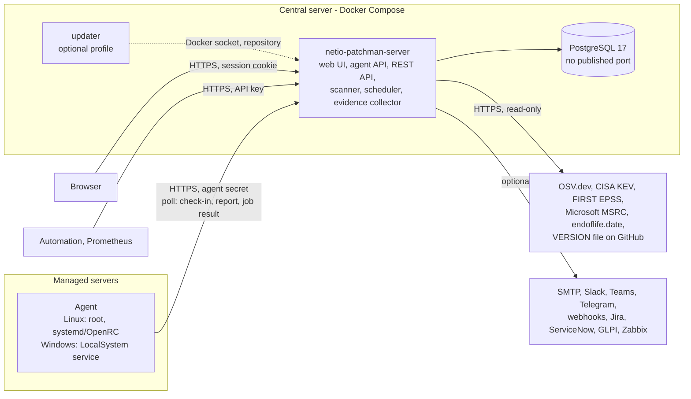

# Architecture and security model

🇬🇧 **English** · 🇹🇷 [Türkçe](mimari-ve-guvenlik.md) · ⏱️ Reading time: about 15 minutes

This document describes how netio.patchman is built, which parts trust which, how data moves between them and which
controls protect it. It is meant for operators deciding where to run it, for security reviewers and for contributors.
Back to the [README](../README.md) · [Wiki](https://github.com/alptekinsunnetci/netio.patchman/wiki)

> [!WARNING]
> netio.patchman runs package updates, service restarts and reboots on your servers. You use it entirely at your own
> risk; see the [Disclaimer](../README.md#disclaimer).

## Contents

- [1. Components](#1-components)
- [2. Data flows](#2-data-flows)
- [3. Trust boundaries](#3-trust-boundaries)
- [4. The agent](#4-the-agent)
- [5. The server and the web interface](#5-the-server-and-the-web-interface)
- [6. Data at rest](#6-data-at-rest)
- [7. Outbound connections](#7-outbound-connections)
- [8. Updates of netio.patchman itself](#8-updates-of-netiopatchman-itself)
- [9. Audit trail and evidence integrity](#9-audit-trail-and-evidence-integrity)
- [10. Threat model](#10-threat-model)
- [11. Hardening checklist](#11-hardening-checklist)
- [12. Reporting a vulnerability](#12-reporting-a-vulnerability)

## 1. Components

| Component | Role | Runs as |
|---|---|---|
| `netio-patchman-server` | One Go binary (CGO off): web interface, agent API, REST API, Prometheus metrics, vulnerability scanner, scheduler, rollouts, notifications, evidence collector, backups | Container, unprivileged user, port 8080 |
| PostgreSQL 17 | All state (SQLite remains supported for small or test installations) | Container on the internal Compose network, no published port |
| `netio-patchman-agent` | Collects inventory and pending updates, runs jobs, reports resource usage | `root` (Linux), `LocalSystem` (Windows): package managers need it |
| `updater` (optional) | Updates the server from the Git repository when an administrator asks for it in the panel | Container with the Docker socket, only with the `updater` Compose profile |

## 2. Data flows

**The agent always starts the connection.** It never listens on a port. Every minute (configurable) it checks in; the
response carries the jobs queued for it, whether an inventory report is due and the monitoring schedule.

| Flow | Direction | Content |
|---|---|---|
| Registration | agent → server | Enrollment token and host facts; the server returns a host id and a new agent secret |
| Check-in | agent → server | Host facts; response: jobs, report schedule, monitoring schedule |
| Report | agent → server (gzip) | Installed packages, pending updates, reboot state, services, product versions |
| Job result | agent → server | Exit code, output (bounded), packages still pending, structured results (health, preview, rollback) |
| Monitoring | agent → server | Health check results, CPU, memory, swap and disk usage |
| Agent download | agent → server | Agent binary for self-update, checked against a SHA-256 the job carries |
| Feeds | server → internet | Vulnerability and support data (read-only requests, see [section 7](#7-outbound-connections)) |
| Notifications | server → channels | Messages to e-mail and chat/ticket systems you configure |

Vulnerability matching happens on the server: the agent only reports package names and versions. Windows hosts report
pending KB updates; the server asks the Microsoft Security Update Guide which CVEs they fix.

## 3. Trust boundaries

| Boundary | What crosses it | How it is protected |
|---|---|---|
| Browser ↔ server | User actions | TLS (built in or reverse proxy), session cookie, CSRF token, Origin/Referer check, CSP, roles |
| Automation ↔ server | REST API calls | TLS, API keys (`npat_…`), read-only keys, per-IP failure limit |
| Agent ↔ server | Inventory, jobs, results | TLS (optional custom CA), per-host agent secret, per-IP failure limit, input validation on both sides |
| Server ↔ database | Everything | Internal network, generated password from a read-only volume |
| Server ↔ internet | Public security data | HTTPS to fixed, configurable addresses; responses parsed as data, never executed |
| Server ↔ Docker host | Self-update (optional) | Updater container only exists with the `updater` profile; it takes no input from the request |

The **agent trusts the server** to tell it which jobs to run, so the server is the most valuable target: whoever
controls it can update packages, restart services and reboot every managed host (but cannot run arbitrary commands, see
below). Protect it like any other configuration management system.

## 4. The agent

**No listening port, no shell, no remote commands.**

- Jobs are a fixed set of types (`refresh`, `upgrade_security`, `upgrade_all`, `upgrade_packages`, `restart_services`,
  `reboot`, `agent_update`, `health_check`, `preview`, `rollback`). Each maps to fixed package manager commands
  (apt, dnf/yum, zypper, apk, Windows Update) started with `exec`, never through a shell.
- Package names are validated on the server and again on the agent (`protocol.ValidPackageName`); service names likewise
  (`ValidServiceName`). Exclusion patterns are parsed with the same rules.
- The panel cannot send a command line. Custom health checks of type `command` only run files in
  `<config dir>/health.d/` that are owned by root and not writable by group or others; the server only names the file.
- Services the agent never restarts: D-Bus, logind, getty, display managers, network services and the agent itself.
  A reboot only happens as an explicit `reboot` job (or a schedule with the opt-in reboot option) and is delayed by a minute
  so the result reaches the server first.
- `PATCHMAN_REMOTE_UPDATES=false` makes a host inventory-only: it reports but runs no package jobs.
- **Credentials:** the enrollment token is used once to register; afterwards the agent authenticates with its own secret
  (32 random bytes) kept in the state directory (`/var/lib/netio-patchman`, mode 0700; `C:\ProgramData\netio-patchman`
  on Windows). The server stores only its SHA-256 hash. Deleting the host on the server revokes the secret.
- **TLS:** the agent verifies the server certificate against the system roots plus an optional CA file
  (`PATCHMAN_CA_FILE`). Plain HTTP is accepted only if you configure an `http://` URL.
- **Self-update:** the job names a version, a SHA-256 and a download path under `/downloads/agent/`. The agent
  downloads, compares the hash, runs the new binary with `-version`, keeps the old one as `.previous` and only then
  replaces itself. `PATCHMAN_AUTO_UPDATE=false` disables it.
- **Windows:** the Windows Update script is embedded in the binary and started with `-EncodedCommand`; its input comes
  from environment variables and job messages come from the message catalog, so no user text ever becomes script code.
- The agent runs as root because package managers require it. Under systemd it uses `PrivateTmp`; file system
  sandboxing is deliberately not used because package maintainer scripts must be able to write where a normal upgrade
  writes.

## 5. The server and the web interface

**Accounts and sessions**

- Passwords: PBKDF2-SHA256 with 600,000 iterations and a random salt.
- Sessions: 32 random bytes in an `HttpOnly`, `SameSite=Lax` cookie (`Secure` over HTTPS); only the SHA-256 hash is
  stored; sessions end after 12 hours without activity.
- Two-step verification: TOTP (RFC 6238), replayed codes are rejected, ten single-use recovery codes stored as hashes.
  Administrators can require it for every user; the pending second step lives in memory for 5 minutes and 5 attempts.
- Failed sign-ins are limited per IP address (8 per 15 minutes); failed API keys and agent secrets likewise.

**Authorization**

- Roles: administrator > operator > viewer. Every route declares the minimum role.
- Operators and viewers can be limited to host groups. The limit is enforced in the data layer: every query that reads
  hosts, findings, updates, jobs, notifications, evidence or reports applies the scope, so a page cannot leak hosts by
  forgetting a check. Fleet-wide pages (schedules, agents, rollouts) are closed to limited users.
- REST API keys (`npat_…`) act as their user, can be read-only and expire; only their hash is stored. The API does not
  accept cookies, so it needs no CSRF protection.

**Request protection**

- Every POST checks a per-session CSRF token and the `Origin`/`Referer` header.
- Content Security Policy: `default-src 'self'; img-src 'self' data:; style-src 'self'; script-src 'self';
  frame-ancestors 'none'; base-uri 'self'; form-action 'self'`, plus `X-Frame-Options: DENY`,
  `X-Content-Type-Options: nosniff`, `Referrer-Policy: same-origin`. The interface has no inline scripts or styles and
  loads nothing from other hosts (works air-gapped).
- Templates escape all output; vulnerability descriptions from feeds are shown as text, never as HTML.
- CSV exports prefix cells that a spreadsheet would treat as formulas.
- Behind a reverse proxy set `PATCHMAN_TRUST_PROXY=true` so client addresses (rate limits, audit log) come from
  `X-Forwarded-For`; otherwise the header is ignored.

## 6. Data at rest

| Data | Stored as |
|---|---|
| User passwords | PBKDF2-SHA256 hash |
| Session tokens, enrollment tokens, agent secrets, API keys, MFA recovery codes | SHA-256 hash only |
| TOTP secrets | Plain (needed to verify codes) |
| SMTP password, channel tokens and webhook secrets | Plain in the database (needed to send); never shown in full in the panel and removed from stored error messages |
| Database password | Generated at first start into the `netio-patchman-db` volume, mounted read-only into the server |
| Inventory, findings, jobs, audit log, evidence | Database |

- **Backups** (`<data>/backups`, daily, also CLI `backup`) are complete SQLite copies of the database. They contain the
  configuration secrets above: store and transfer them like credentials. Downloading one from the panel is admin-only
  and audited.
- Retention: resolved findings, finished jobs and notifications follow `retention.days` (default 90); the audit log is
  kept 365 days; compliance evidence has its own retention (default 1095 days, minimum 400).
- The database URL is never written to logs.

## 7. Outbound connections

The server needs no inbound connection from the internet. It makes read-only HTTPS requests to:

| Destination | Purpose | Setting |
|---|---|---|
| `api.osv.dev` | Vulnerability records | `PATCHMAN_OSV_URL` / Server configuration |
| CISA KEV catalog | Actively exploited vulnerabilities | `sources.kev_*` |
| FIRST EPSS | Exploit probability | `sources.epss_*` |
| Microsoft Security Update Guide | CVEs fixed by Windows KB updates | `PATCHMAN_MSRC_URL` |
| endoflife.date | Support calendars | `PATCHMAN_EOL_URL` |
| `VERSION` file on GitHub | New release notice (only the User-Agent is sent) | `PATCHMAN_UPDATE_CHECK_URL=off` disables it |

Each address can be changed (for example to an internal mirror) or the feature turned off. No inventory or host
data leaves your network through these requests; OSV queries contain package names and versions only.
Notifications go only to the channels you configure.

## 8. Updates of netio.patchman itself

- **Agents** update themselves as described in [section 4](#4-the-agent), from the binaries bundled with the server image.
- **The server** is updated with `git pull` and `docker compose up -d --build`, or from the panel with the optional
  `updater` service. That service mounts the Docker socket, which is equivalent to root on the Docker host. It is not
  started unless you enable the `updater` profile; the server only writes a request file and the updater runs the fixed
  script from the repository (pull, backup, build, restart, health check) without taking any parameters from the request.
  If you do not want any container with the Docker socket, leave the profile off.

## 9. Audit trail and evidence integrity

- Security-relevant actions (sign-ins and failures, user and role changes, MFA changes, settings, jobs, approvals,
  schedules, rollouts, token and API key changes, backups, exports, compliance reports) are written to the audit log
  with user and IP address.
- The compliance evidence repository copies jobs, resolved findings, the audit log, drift, backups and daily host states
  into an append-only table. Every item's SHA-256 covers its content and the hash of the item before it; the chain head
  is stored separately. **Audit History → Evidence integrity** recomputes the chain and reports changed, removed or
  inserted items. Final report versions are frozen and carry their own hash.
- These mechanisms make tampering detectable, not impossible: an attacker with database and server access can rebuild a
  chain. Export final report versions (PDF/JSON with hashes) and keep them outside the server if you need independent proof.

## 10. Threat model

| Threat | Mitigation | Residual risk |
|---|---|---|
| Stolen admin password | PBKDF2, rate limiting, optional mandatory MFA, audit log | Phished TOTP codes |
| Compromised server | Agents accept only fixed job types, validated names, no commands; hashed agent secrets | Attacker can update, restart services and reboot every host; protect the server accordingly |
| Malicious agent or stolen agent secret | Secret per host, server validates and bounds all input, cannot read other hosts' data | It can send false inventory for its own host |
| Network attacker between agent and server | TLS with certificate verification, custom CA option | Only if you use `http://` |
| CSRF, clickjacking, XSS | CSRF token + Origin check, `frame-ancestors 'none'`, strict CSP, escaped templates | — |
| Malicious feed data | Parsed as data, shown as text, never executed | Wrong or missing vulnerability data affects findings |
| Leaked backup file | Hashes for all tokens and passwords | Configuration secrets (SMTP, channels) and inventory are readable |
| Docker socket in the updater | Off by default, fixed script, no request parameters | Root-equivalent on the Docker host while enabled |
| Tampering with evidence | Hash chain, final versions, exports | An attacker with full access can rebuild the chain |

## 11. Hardening checklist

1. Serve the panel over HTTPS only (built-in TLS with `PATCHMAN_TLS_CERT_FILE`/`PATCHMAN_TLS_KEY_FILE`, or a reverse
   proxy with `PATCHMAN_TRUST_PROXY=true`) and set `PATCHMAN_BASE_URL` to the `https://` address.
2. Do not expose the panel to the internet if you do not need to; agents only need to reach the server.
3. Require two-step verification for all users (**System settings → Security**).
4. Give people the lowest role they need, use group limits for teams, and use read-only API keys with an expiry.
5. Use short-lived enrollment tokens with a use limit and revoke them after rollout.
6. Keep the `updater` profile off unless you use panel-driven updates.
7. Protect backup files like credentials; copy them off the server encrypted.
8. Leave remote updates off (`PATCHMAN_REMOTE_UPDATES=false`) on hosts that must only be inventoried.
9. Point feeds at internal mirrors in air-gapped networks, or disable the ones you do not use.
10. Review the audit log and the evidence integrity check regularly.

## 12. Reporting a vulnerability

Please report security issues privately through GitHub ([Report a vulnerability](https://github.com/alptekinsunnetci/netio.patchman/security/advisories/new)) and do not open a public
issue for them. Include the version, the affected component and the steps to reproduce. Supported versions, scope and
what to expect: [security policy](../SECURITY.md).
