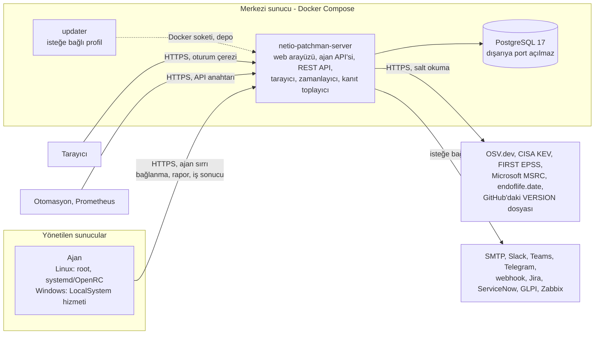

# Mimari ve güvenlik modeli

🇬🇧 [English](architecture-and-security.md) · 🇹🇷 **Türkçe** · ⏱️ Okuma süresi: yaklaşık 15 dakika

Bu belge netio.patchman'in nasıl kurulduğunu, hangi bileşenin hangisine güvendiğini, verinin bileşenler arasında nasıl
aktığını ve onu hangi önlemlerin koruduğunu anlatır. Nerede çalıştıracağına karar veren sistem yöneticileri, güvenlik
incelemesi yapanlar ve katkıda bulunacak geliştiriciler içindir.
[README](../README.tr.md)'ye dön · [Wiki](https://github.com/alptekinsunnetci/netio.patchman/wiki)

> [!WARNING]
> netio.patchman sunucularınızda paket günceller, servisleri ve sunucuyu yeniden başlatır. Kullanım riski tamamen
> kullanıcıya aittir; bkz. [Sorumluluk reddi](../README.tr.md#sorumluluk-reddi).

## İçindekiler

- [1. Bileşenler](#1-bileşenler)
- [2. Veri akışları](#2-veri-akışları)
- [3. Güven sınırları](#3-güven-sınırları)
- [4. Ajan](#4-ajan)
- [5. Sunucu ve web arayüzü](#5-sunucu-ve-web-arayüzü)
- [6. Saklanan veri](#6-saklanan-veri)
- [7. Dışarıya yapılan bağlantılar](#7-dışarıya-yapılan-bağlantılar)
- [8. netio.patchman'in kendi güncellemeleri](#8-netiopatchmanin-kendi-güncellemeleri)
- [9. Denetim kaydı ve kanıt bütünlüğü](#9-denetim-kaydı-ve-kanıt-bütünlüğü)
- [10. Tehdit modeli](#10-tehdit-modeli)
- [11. Sıkılaştırma listesi](#11-sıkılaştırma-listesi)
- [12. Güvenlik açığı bildirimi](#12-güvenlik-açığı-bildirimi)

## 1. Bileşenler

| Bileşen | Görevi | Çalıştığı kullanıcı |
|---|---|---|
| `netio-patchman-server` | Tek Go programı (CGO kapalı): web arayüzü, ajan API'si, REST API, Prometheus metrikleri, açık tarayıcı, zamanlayıcı, kademeli güncellemeler, bildirimler, kanıt toplayıcı, yedekleme | Konteyner, ayrıcalıksız kullanıcı, 8080 portu |
| PostgreSQL 17 | Tüm durum (küçük ve test kurulumları için SQLite da desteklenir) | Compose iç ağında konteyner, dışarıya port açılmaz |
| `netio-patchman-agent` | Envanteri ve bekleyen güncellemeleri toplar, işleri çalıştırır, kaynak kullanımını bildirir | `root` (Linux), `LocalSystem` (Windows): paket yöneticileri bunu gerektirir |
| `updater` (isteğe bağlı) | Yönetici panelden istediğinde sunucuyu Git deposundan günceller | Docker soketine erişen konteyner, yalnızca `updater` Compose profiliyle |

## 2. Veri akışları

**Bağlantıyı her zaman ajan başlatır.** Ajan hiçbir portu dinlemez. Varsayılan olarak dakikada bir sunucuya bağlanır;
yanıtta kendisi için kuyruğa alınmış işler, envanter raporunun zamanı gelip gelmediği ve izleme planı bulunur.

| Akış | Yön | İçerik |
|---|---|---|
| Kayıt | ajan → sunucu | Kayıt anahtarı ve sunucu bilgileri; sunucu bir kimlik ve yeni bir ajan sırrı döndürür |
| Bağlanma (check-in) | ajan → sunucu | Sunucu bilgileri; yanıt: işler, rapor ve izleme planı |
| Rapor | ajan → sunucu (gzip) | Kurulu paketler, bekleyen güncellemeler, yeniden başlatma durumu, servisler, ürün sürümleri |
| İş sonucu | ajan → sunucu | Çıkış kodu, sınırlı çıktı, hâlâ bekleyen paketler, yapılandırılmış sonuçlar (sağlık, önizleme, geri dönüş) |
| İzleme | ajan → sunucu | Sağlık kontrolü sonuçları; işlemci, bellek, takas ve disk kullanımı |
| Ajan indirme | ajan → sunucu | Kendini güncellemek için ajan dosyası, işteki SHA-256 ile karşılaştırılır |
| Veri kaynakları | sunucu → internet | Güvenlik açığı ve destek verisi (salt okuma, bkz. [bölüm 7](#7-dışarıya-yapılan-bağlantılar)) |
| Bildirimler | sunucu → kanallar | Tanımladığınız e-posta ve sohbet/kayıt sistemlerine mesajlar |

Güvenlik açığı eşleştirmesi sunucuda yapılır; ajan yalnızca paket adlarını ve sürümlerini bildirir. Windows sunucuları
bekleyen KB güncellemelerini bildirir; sunucu bunların hangi CVE'leri kapattığını Microsoft Security Update Guide'a sorar.

## 3. Güven sınırları

| Sınır | Geçen veri | Koruma |
|---|---|---|
| Tarayıcı ↔ sunucu | Kullanıcı işlemleri | TLS (yerleşik veya ters vekil), oturum çerezi, CSRF anahtarı, Origin/Referer denetimi, CSP, roller |
| Otomasyon ↔ sunucu | REST API çağrıları | TLS, API anahtarları (`npat_…`), salt okunur anahtarlar, IP bazında hatalı deneme sınırı |
| Ajan ↔ sunucu | Envanter, işler, sonuçlar | TLS (isteğe bağlı özel CA), sunucuya özel ajan sırrı, IP bazında hatalı deneme sınırı, iki tarafta girdi doğrulama |
| Sunucu ↔ veritabanı | Tüm veri | İç ağ, salt okunur birimden okunan üretilmiş parola |
| Sunucu ↔ internet | Herkese açık güvenlik verisi | Sabit ve değiştirilebilir adreslere HTTPS; yanıtlar veri olarak işlenir, asla çalıştırılmaz |
| Sunucu ↔ Docker ana makinesi | Kendini güncelleme (isteğe bağlı) | Updater konteyneri yalnızca `updater` profiliyle vardır; istekten hiçbir girdi almaz |

**Ajan, hangi işleri çalıştıracağı konusunda sunucuya güvenir.** Bu yüzden en değerli hedef sunucudur: onu ele geçiren
her yönetilen sunucuda paket güncelleyebilir, servisleri ve sunucuyu yeniden başlatabilir (ancak keyfi komut
çalıştıramaz, aşağıya bakın). Sunucuyu diğer yapılandırma yönetim sistemleri gibi koruyun.

## 4. Ajan

**Dinlenen port yok, kabuk yok, uzaktan komut yok.**

- İşler sabit türlerdir (`refresh`, `upgrade_security`, `upgrade_all`, `upgrade_packages`, `restart_services`,
  `reboot`, `agent_update`, `health_check`, `preview`, `rollback`). Her biri sabit paket yöneticisi komutlarına karşılık
  gelir (apt, dnf/yum, zypper, apk, Windows Update) ve kabuk kullanılmadan `exec` ile başlatılır.
- Paket adları sunucuda ve ajanda yeniden doğrulanır (`protocol.ValidPackageName`); servis adları da öyle
  (`ValidServiceName`). Hariç tutma kalıpları aynı kurallarla ayrıştırılır.
- Panel ajana komut satırı gönderemez. `command` türündeki özel sağlık kontrolleri yalnızca `<yapılandırma dizini>/health.d/`
  içindeki, root'a ait ve grup ya da diğer kullanıcılarca yazılamayan dosyaları çalıştırır; sunucu yalnızca dosyanın adını bildirir.
- Ajanın hiçbir zaman yeniden başlatmadığı servisler: D-Bus, logind, getty, ekran yöneticileri, ağ servisleri ve ajanın
  kendisi. Yeniden başlatma yalnızca açık bir `reboot` işiyle (veya yeniden başlatma seçeneği açık bir zamanlamayla)
  olur ve sonuç sunucuya ulaşsın diye bir dakika ertelenir.
- `PATCHMAN_REMOTE_UPDATES=false` sunucuyu yalnızca envanter gönderen hale getirir; paket işi çalıştırmaz.
- **Kimlik bilgileri:** kayıt anahtarı yalnızca kayıt için bir kez kullanılır; sonrasında ajan kendi sırrıyla (32 rastgele
  bayt) kimlik doğrular. Sır durum dizininde tutulur (`/var/lib/netio-patchman`, izin 0700; Windows'ta
  `C:\ProgramData\netio-patchman`). Sunucu yalnızca SHA-256 özetini saklar. Sunucu panelden silinince sır geçersiz olur.
- **TLS:** ajan sunucu sertifikasını sistem kök sertifikaları ve isteğe bağlı bir CA dosyasıyla (`PATCHMAN_CA_FILE`)
  doğrular. Düz HTTP yalnızca `http://` adresi yapılandırırsanız kullanılır.
- **Kendini güncelleme:** iş bir sürüm, bir SHA-256 özeti ve `/downloads/agent/` altında bir yol içerir. Ajan dosyayı
  indirir, özeti karşılaştırır, yeni dosyayı `-version` ile çalıştırıp sürümünü denetler, eskisini `.previous` olarak
  saklar ve ancak bundan sonra kendini değiştirir. `PATCHMAN_AUTO_UPDATE=false` bunu kapatır.
- **Windows:** Windows Update betiği ajan dosyasına gömülüdür ve `-EncodedCommand` ile başlatılır; girdisini ortam
  değişkenlerinden alır, iş mesajları ileti kataloğundan gelir. Böylece hiçbir kullanıcı metni betik koduna dönüşmez.
- Ajan root olarak çalışır, çünkü paket yöneticileri bunu gerektirir. systemd altında `PrivateTmp` kullanılır; dosya
  sistemi kısıtlaması bilinçli olarak kullanılmaz, çünkü paket betikleri normal bir yükseltmenin yazdığı her yere yazabilmelidir.

## 5. Sunucu ve web arayüzü

**Hesaplar ve oturumlar**

- Parolalar: 600.000 yinelemeli, rastgele tuzlu PBKDF2-SHA256.
- Oturumlar: `HttpOnly`, `SameSite=Lax` çerezde 32 rastgele bayt (HTTPS'te `Secure`); yalnızca SHA-256 özeti saklanır;
  12 saat işlem yapılmazsa oturum biter.
- İki adımlı doğrulama: TOTP (RFC 6238), tekrar kullanılan kodlar reddedilir, özetleri saklanan on tek kullanımlık
  kurtarma kodu. Yöneticiler tüm kullanıcılar için zorunlu kılabilir; bekleyen ikinci adım bellekte 5 dakika ve 5 deneme tutulur.
- Hatalı girişler IP adresi başına sınırlıdır (15 dakikada 8); hatalı API anahtarları ve ajan sırları da öyle.

**Yetkilendirme**

- Roller: yönetici > operatör > izleyici. Her adres gereken en düşük rolü belirtir.
- Operatör ve izleyiciler sunucu gruplarıyla sınırlandırılabilir. Sınır veri katmanında uygulanır: sunucuları, bulguları,
  güncellemeleri, işleri, bildirimleri, kanıtları veya raporları okuyan her sorgu kapsamı uygular; bir sayfa bir denetimi
  unutarak başka sunucuları gösteremez. Filo geneli sayfalar (zamanlamalar, ajanlar, kademeli güncellemeler) sınırlı
  kullanıcılara kapalıdır.
- REST API anahtarları (`npat_…`) sahibi kullanıcı adına çalışır, salt okunur olabilir ve süreleri dolabilir; yalnızca
  özetleri saklanır. API çerez kabul etmediği için CSRF korumasına ihtiyaç duymaz.

**İstek koruması**

- Her POST isteği oturuma özel CSRF anahtarını ve `Origin`/`Referer` başlığını denetler.
- İçerik güvenlik politikası: `default-src 'self'; img-src 'self' data:; style-src 'self'; script-src 'self';
  frame-ancestors 'none'; base-uri 'self'; form-action 'self'`; ayrıca `X-Frame-Options: DENY`,
  `X-Content-Type-Options: nosniff`, `Referrer-Policy: same-origin`. Arayüzde satır içi betik veya stil yoktur ve başka
  bir sunucudan hiçbir şey yüklenmez (internet erişimi olmayan ağlarda çalışır).
- Şablonlar tüm çıktıyı kaçışlar; veri kaynaklarından gelen açık açıklamaları HTML olarak değil, metin olarak gösterilir.
- CSV dışa aktarımları, tablo programlarının formül sayacağı hücrelerin başına kesme işareti koyar.
- Ters vekil arkasında `PATCHMAN_TRUST_PROXY=true` ayarlayın; böylece istemci adresleri (deneme sınırı, denetim kaydı)
  `X-Forwarded-For` başlığından alınır. Aksi halde bu başlık yok sayılır.

## 6. Saklanan veri

| Veri | Saklanma biçimi |
|---|---|
| Kullanıcı parolaları | PBKDF2-SHA256 özeti |
| Oturum anahtarları, kayıt anahtarları, ajan sırları, API anahtarları, MFA kurtarma kodları | Yalnızca SHA-256 özeti |
| TOTP gizli anahtarları | Düz (kodu doğrulamak için gerekir) |
| SMTP parolası, kanal anahtarları ve webhook sırları | Veritabanında düz (gönderim için gerekir); panelde hiçbir zaman tam gösterilmez, kaydedilen hata mesajlarından çıkarılır |
| Veritabanı parolası | İlk açılışta `netio-patchman-db` birimine üretilir, sunucuya salt okunur bağlanır |
| Envanter, bulgular, işler, denetim kaydı, kanıtlar | Veritabanı |

- **Yedekler** (`<veri>/backups`, günlük; ayrıca CLI `backup`) veritabanının tam SQLite kopyalarıdır. Yukarıdaki
  yapılandırma sırlarını içerirler: yedekleri parolalar gibi saklayın ve taşıyın. Panelden indirmek yalnızca yöneticilere
  açıktır ve denetim kaydına yazılır.
- Saklama süreleri: çözülen bulgular, biten işler ve bildirimler `retention.days` ayarına uyar (varsayılan 90 gün);
  denetim kaydı 365 gün tutulur; uyum kanıtlarının kendi saklama süresi vardır (varsayılan 1095, en az 400 gün).
- Veritabanı adresi hiçbir zaman günlüklere yazılmaz.

## 7. Dışarıya yapılan bağlantılar

Sunucuya internetten gelen bağlantı gerekmez. Sunucu şu adreslere salt okuma amaçlı HTTPS istekleri yapar:

| Hedef | Amaç | Ayar |
|---|---|---|
| `api.osv.dev` | Güvenlik açığı kayıtları | `PATCHMAN_OSV_URL` / Sunucu yapılandırması |
| CISA KEV kataloğu | Aktif olarak istismar edilen açıklar | `sources.kev_*` |
| FIRST EPSS | İstismar olasılığı | `sources.epss_*` |
| Microsoft Security Update Guide | Windows KB güncellemelerinin kapattığı CVE'ler | `PATCHMAN_MSRC_URL` |
| endoflife.date | Destek takvimleri | `PATCHMAN_EOL_URL` |
| GitHub'daki `VERSION` dosyası | Yeni sürüm bildirimi (yalnızca User-Agent gönderilir) | `PATCHMAN_UPDATE_CHECK_URL=off` kapatır |

Her adres değiştirilebilir (örneğin iç ağdaki bir yansıya) veya özellik kapatılabilir. Bu isteklerle ağınızdan envanter
ya da sunucu bilgisi çıkmaz; OSV sorguları yalnızca paket adı ve sürümünü içerir. Bildirimler yalnızca tanımladığınız
kanallara gider.

## 8. netio.patchman'in kendi güncellemeleri

- **Ajanlar** [bölüm 4](#4-ajan)'te anlatıldığı gibi, sunucu imajındaki ajan dosyalarından kendilerini günceller.
- **Sunucu** `git pull` ve `docker compose up -d --build` ile ya da isteğe bağlı `updater` servisiyle panelden
  güncellenir. Bu servis Docker soketini bağlar; bu, Docker ana makinesinde root yetkisine denktir. `updater` profilini
  açmadıkça başlatılmaz. Sunucu yalnızca bir istek dosyası yazar; updater depodaki sabit betiği (pull, yedek, derleme,
  yeniden başlatma, sağlık denetimi) istekten hiçbir parametre almadan çalıştırır. Docker soketine erişen bir konteyner
  istemiyorsanız profili kapalı bırakın.

## 9. Denetim kaydı ve kanıt bütünlüğü

- Güvenlikle ilgili işlemler (girişler ve başarısız denemeler, kullanıcı ve rol değişiklikleri, MFA değişiklikleri,
  ayarlar, işler, onaylar, zamanlamalar, kademeli güncellemeler, anahtar değişiklikleri, yedekler, dışa aktarmalar, uyum
  raporları) kullanıcı ve IP adresiyle denetim kaydına yazılır.
- Uyum kanıt deposu işleri, çözülen bulguları, denetim kaydını, sapmaları, yedekleri ve günlük sunucu durumlarını yalnızca
  ekleme yapılan bir tabloya kopyalar. Her kaydın SHA-256 özeti içeriğini ve bir önceki kaydın özetini kapsar; zincirin
  başı ayrıca saklanır. **Denetim Geçmişi → Kanıt bütünlüğü** zinciri yeniden hesaplar ve değiştirilen, silinen veya araya
  eklenen kayıtları gösterir. Kesinleşen rapor sürümleri dondurulur ve kendi özetlerini taşır.
- Bu mekanizmalar değişikliği tespit edilebilir kılar, imkânsız kılmaz: veritabanına ve sunucuya erişimi olan bir
  saldırgan zinciri yeniden oluşturabilir. Bağımsız kanıt gerekiyorsa kesinleşen rapor sürümlerini (özetleriyle PDF/JSON)
  dışa aktarın ve sunucu dışında saklayın.

## 10. Tehdit modeli

| Tehdit | Önlem | Kalan risk |
|---|---|---|
| Çalınan yönetici parolası | PBKDF2, deneme sınırı, zorunlu kılınabilen MFA, denetim kaydı | Oltalamayla ele geçirilen TOTP kodları |
| Ele geçirilen sunucu | Ajanlar yalnızca sabit iş türlerini, doğrulanmış adları kabul eder, komut çalıştırmaz; ajan sırları özetle saklanır | Saldırgan tüm sunucularda güncelleme, servis yeniden başlatma ve yeniden başlatma yapabilir; sunucuyu buna göre koruyun |
| Kötü niyetli ajan veya çalınan ajan sırrı | Sunucuya özel sır; sunucu tüm girdiyi doğrular ve sınırlar; diğer sunucuların verisi okunamaz | Kendi sunucusu için yanlış envanter gönderebilir |
| Ajanla sunucu arasındaki ağ saldırganı | Sertifika doğrulamalı TLS, özel CA seçeneği | Yalnızca `http://` kullanılırsa |
| CSRF, tıklama tuzağı, XSS | CSRF anahtarı + Origin denetimi, `frame-ancestors 'none'`, katı CSP, kaçışlanan şablonlar | — |
| Kötü niyetli veri kaynağı | Veri olarak işlenir, metin olarak gösterilir, asla çalıştırılmaz | Yanlış veya eksik açık verisi bulguları etkiler |
| Sızan yedek dosyası | Tüm anahtar ve parolalar özetle saklanır | Yapılandırma sırları (SMTP, kanallar) ve envanter okunabilir |
| Updater'daki Docker soketi | Varsayılan kapalı, sabit betik, istekten parametre yok | Açıkken Docker ana makinesinde root yetkisine denk |
| Kanıtların değiştirilmesi | Özet zinciri, kesin sürümler, dışa aktarımlar | Tam erişimi olan saldırgan zinciri yeniden oluşturabilir |

## 11. Sıkılaştırma listesi

1. Paneli yalnızca HTTPS üzerinden sunun (`PATCHMAN_TLS_CERT_FILE`/`PATCHMAN_TLS_KEY_FILE` ile yerleşik TLS veya
   `PATCHMAN_TRUST_PROXY=true` ile ters vekil) ve `PATCHMAN_BASE_URL` değerini `https://` adresi yapın.
2. Gerekmiyorsa paneli internete açmayın; ajanların yalnızca sunucuya erişebilmesi yeterlidir.
3. Tüm kullanıcılar için iki adımlı doğrulamayı zorunlu kılın (**Sistem Ayarları → Güvenlik**).
4. Herkese gereken en düşük rolü verin, ekipler için grup sınırı kullanın, süreli ve salt okunur API anahtarları tercih edin.
5. Kısa süreli ve kullanım sınırlı kayıt anahtarları kullanın, kurulum bitince iptal edin.
6. Panelden güncelleme kullanmıyorsanız `updater` profilini kapalı tutun.
7. Yedek dosyalarını parolalar gibi koruyun; sunucu dışına şifreli kopyalayın.
8. Yalnızca envanteri izlenecek sunucularda uzaktan güncellemeleri kapatın (`PATCHMAN_REMOTE_UPDATES=false`).
9. İnternet erişimi olmayan ağlarda veri kaynaklarını iç yansılara yönlendirin veya kullanmadıklarınızı kapatın.
10. Denetim kaydını ve kanıt bütünlüğü denetimini düzenli olarak gözden geçirin.

## 12. Güvenlik açığı bildirimi

Güvenlik sorunlarını herkese açık bir konu (issue) açmadan GitHub üzerinden özel olarak bildirin
([Report a vulnerability](https://github.com/alptekinsunnetci/netio.patchman/security/advisories/new)). Sürümü, etkilenen bileşeni ve sorunu yeniden üretme adımlarını ekleyin. Desteklenen
sürümler, kapsam ve süreç: [güvenlik politikası](../SECURITY.md#türkçe-özet).
